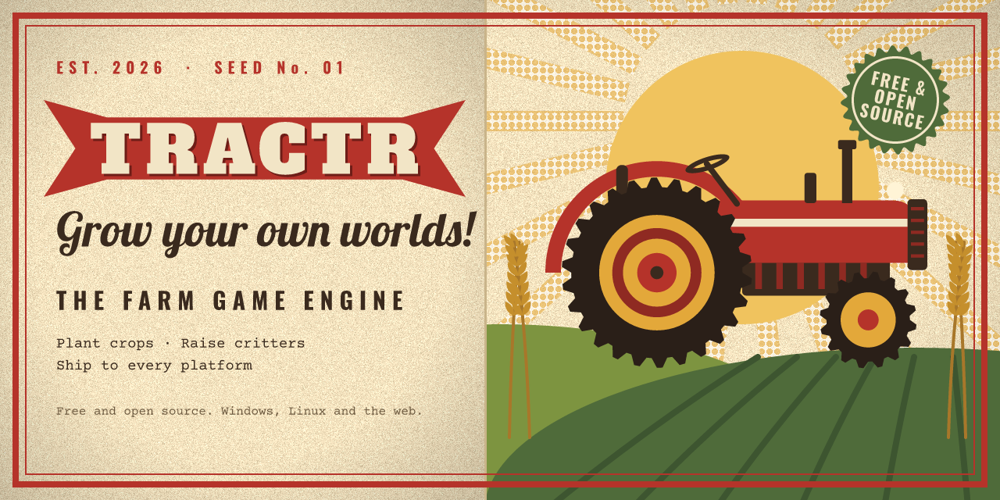
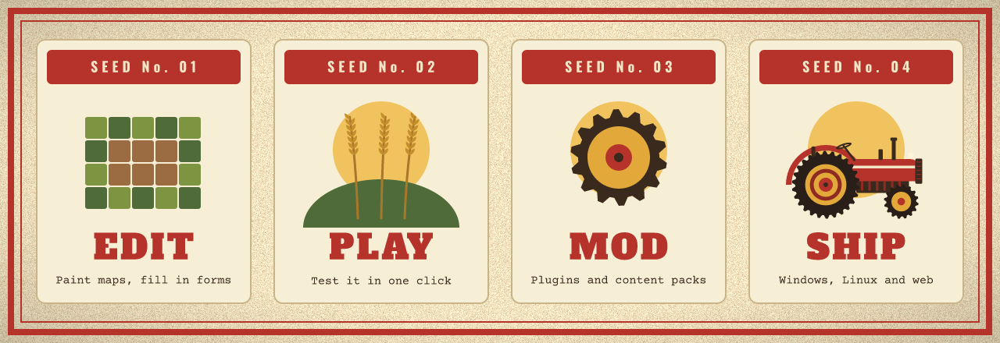
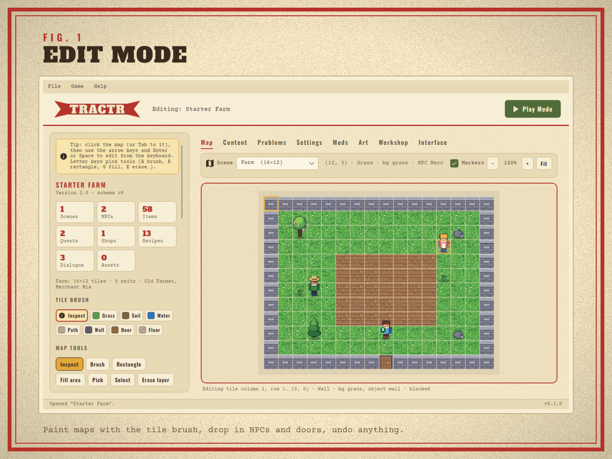
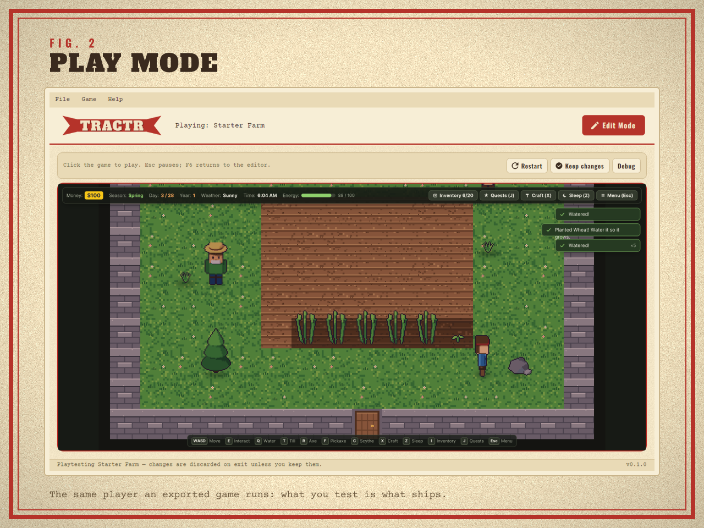
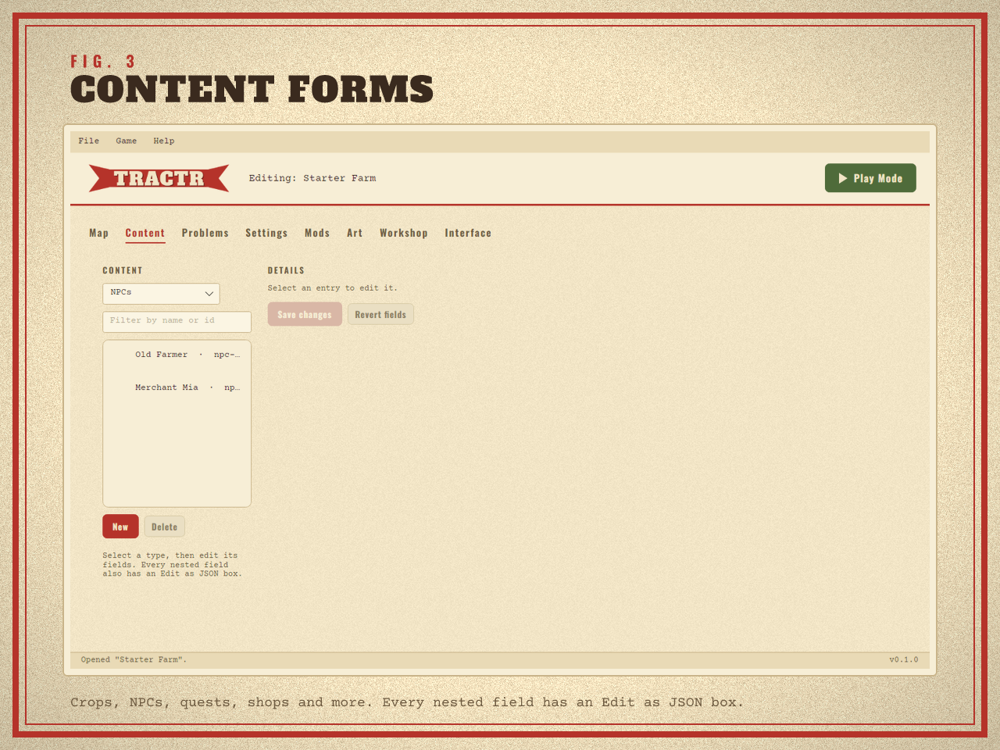
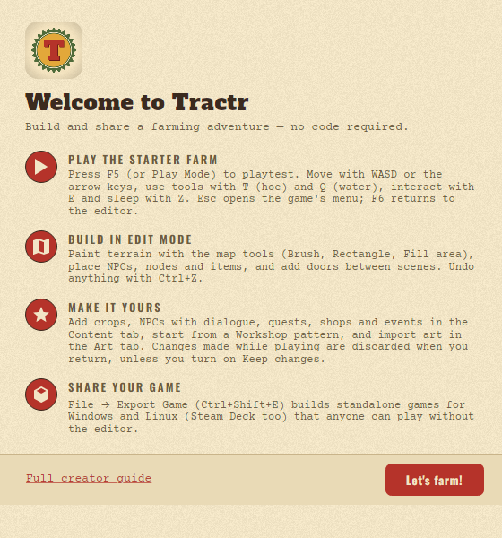
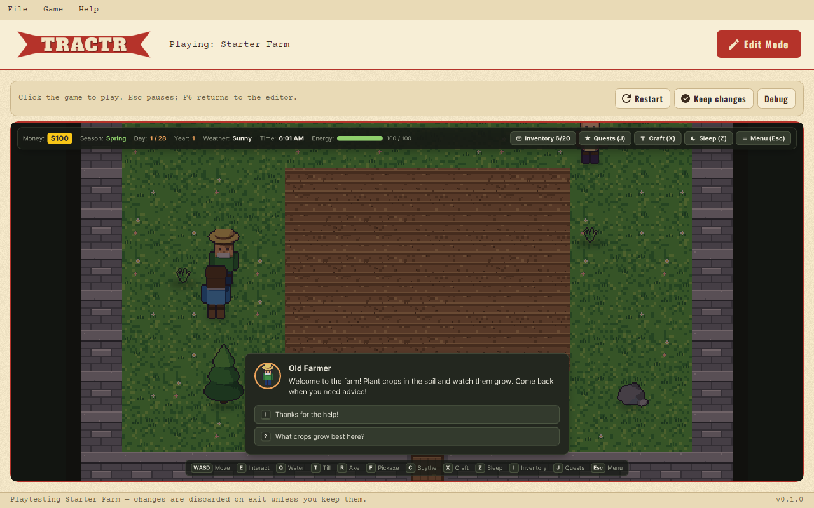

# Tractr: the farm game engine

*Grow your own worlds!* Tractr is a desktop app for making 2D farming games
without writing code. Lay out the fields, plant the crops, write the
neighbours and their quests, playtest as you go, then ship your game to
Windows, Linux, the Steam Deck and the web. It is free to use until a game
you make with it earns US$1,000,000 ([licensing](LICENSING.md)), and its
source is public.

## A look around

| Welcome | Talking to the Old Farmer | Update Center |
|---|---|---|
|  |  |  |

The farm in these pictures is the Starter Farm that ships with Tractr. The
games you make look like games, not like the editor: they keep their own art
and interface.

## What you can make

- **Farms and worlds.** Paint maps up to 512×512 tiles with layers,
  autotiling terrain, tall objects and lights; link scenes with doors. The
  ground, tools, item kinds, crop qualities and sky are yours to define, so
  a game can just as well be set on an alien planet.
- **A full farming life.** Crops with seasons, quality and growth needs;
  machines, recipes and crafting; animals and their barns; fishing, forage
  and mines; buildings a builder puts up; shipping bins, collections,
  bundles, achievements and mail.
- **People and stories.** NPCs with daily routines and lines, gifts,
  friendship, dating and marriage; quests, request boards, festivals and
  cutscenes; events with triggers, conditions and outcomes, no code needed.
- **Your own touches.** Import pictures and sounds, use the Workshop's
  ready-made patterns, add game panels, combat, skills and perks.
- **Mods.** Content packs add content, and their sandboxed JavaScript
  plugins add systems of their own.
- **Real games.** Export standalone Windows and Linux games (Steam Deck
  ready) and a web demo for itch.io, with a title screen, save slots,
  settings, gamepad support and accessibility options. Players need nothing
  else.

The same seed and the same inputs always give the same game, on the
desktop, in exported games and in the browser, and Play Mode runs exactly
the player your exported game ships.

## Get started

1. **Install** Tractr from the
   [latest release](https://github.com/JX-Holdings-LLC/tractr/releases/latest):
   `Tractr-win-Setup.exe` on Windows, the AppImage on Linux, or the zip for
   your Mac ([install guide](docs/INSTALL.md)). It updates itself through
   **Help → Update Center**.
2. **Create a project** with **File → New Project** and the Starter Farm
   template.
3. **Play it**: press **F5**, walk with WASD, till with T, water with Q,
   interact with E and sleep with Z. **F6** goes back to the editor, and the
   world is as it was.
4. **Make it yours** in Edit Mode: paint the map, add crops, people and
   quests in the Content tab, import art in the Art tab.
5. **Share it** with **File → Export Game**.

The [Creator guide](docs/CREATOR-GUIDE.md) (also **Help → Creator Guide**,
F1, in the app) walks through all of it.

## Documentation

| For | Start here |
|---|---|
| Making games | [Creator guide](docs/CREATOR-GUIDE.md), [Export Game](docs/EXPORT.md), [The game player](docs/PLAYER.md), [Troubleshooting](docs/TROUBLESHOOTING.md) |
| Making packs and plugins | [Content packs](docs/PACKS.md), [Pack plugins](docs/PLUGINS.md) |
| Working on Tractr | [CONTRIBUTING.md](CONTRIBUTING.md), [the contributor handbook](docs/dev/README.md) |

The [handbook](docs/README.md) lists every page.

## License

Tractr is source-available under the
[Business Source License 1.1](LICENSE) from JX Holdings, LLC. It is free to
use, and free to ship in games you sell, until a game you make with it earns
US$1,000,000; that game then needs a commercial license, and your other games
do not. Your games' content, and the packs and plugins you write, are yours.
Each version becomes MIT four years after it is published.
[LICENSING.md](LICENSING.md) answers the common questions in plain words.

## Contributing

Tractr's engine and player are Rust, its project logic and Export Game F#,
and the editor C# on .NET 10 with [Avalonia](https://avaloniaui.net).
[CONTRIBUTING.md](CONTRIBUTING.md) covers building from source, testing and
the checks CI runs; [ROADMAP.md](ROADMAP.md) has what is planned; and
[SECURITY.md](SECURITY.md) how to report a vulnerability. Tractr was called
*Farming RPG Maker* until version 0.4.0.
