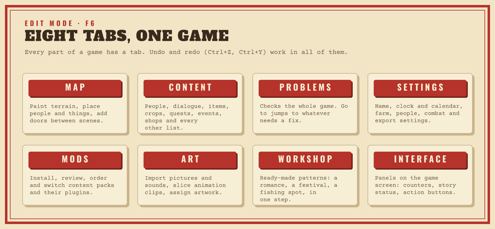
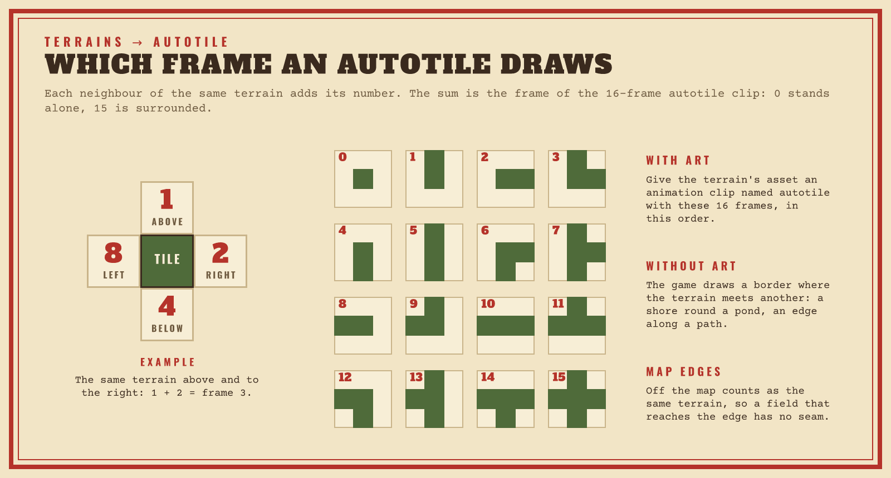
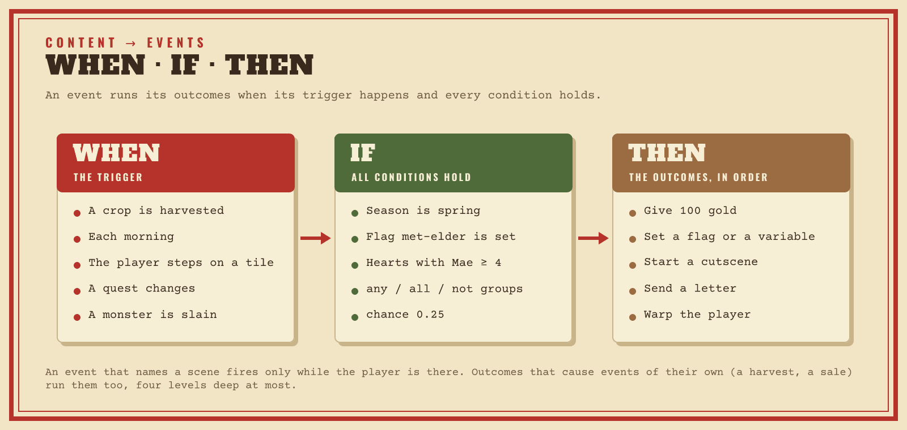
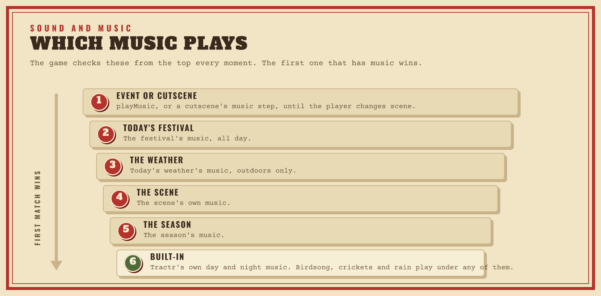
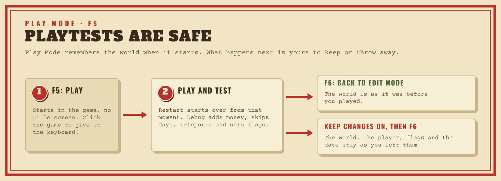

# Creator guide: build a farm game without code

This guide walks through Tractr on the desktop: start a project, build the
world in **Edit Mode**, playtest in **Play Mode**, and export a game that
anyone can play. Everything happens in the editor; you never need to write
code. The editor shows this guide under **Help → Creator Guide** (F1).


New to Tractr? Read sections 1, 3 and 4 first, then come back to section 2
for the part of your game you are working on. For installing Tractr see
[Install and update](INSTALL.md); when something does not work, see
[Troubleshooting](TROUBLESHOOTING.md).

Contents:

- [1. Start a project](#1-start-a-project)
- [2. Build the world in Edit Mode](#2-build-the-world-in-edit-mode): the
  [map](#map), [content](#content), [your game's world](#your-games-world),
  [people](#people-and-relationships), [events](#event-logic),
  [cutscenes](#cutscenes), [quests](#quests-request-boards-and-mines),
  [the farm](#building-the-farm), [gathering and fishing](#gathering-forage-and-fishing),
  [progression](#player-progression-skills-and-food-buffs),
  [the calendar](#weekdays-routines-and-shop-calendars), [festivals](#festivals),
  [goals](#long-term-goals), [combat](#combat-and-adventure),
  [sound](#sound-and-music), [art](#art), [Workshop](#workshop),
  [Interface](#interface), [Mods](#mods), [Settings](#settings) and
  [Problems](#problems)
- [3. Playtest in Play Mode](#3-playtest-in-play-mode)
- [4. Share your game](#4-share-your-game)
- [Player controls](#player-controls-default)

## 1. Start a project

**File → New Project** (Ctrl+N) asks for a name and a template:

- **Starter Farm**: the full farming loop, with crops, a shop, quests and crafting.
- **Cozy Garden**: a cottage garden with a pond, beds already growing (one
  ready to pick), a merchant's stall and two hens; no energy or collapse,
  and slow days.
- **Quest RPG**: a story quest chain, gated dialogue and an elder NPC to
  remix; the farm's south gate leads to a village square with a fountain,
  where the elder and the lantern keeper wait.
- **Blank**: an empty scene and the default item catalog.

**File → Open Project** (Ctrl+O) lists your projects. Tractr saves them
automatically in its data folder:

| System | Projects folder |
|---|---|
| Windows | `%APPDATA%\Tractr\projects\` |
| Linux | `~/.config/Tractr/projects/` |
| macOS | `~/Library/Application Support/Tractr/projects/` |

Each project is a folder of ordinary files:

```text
WillowCreek/
  project.json      settings, content lists and everything else
  scenes/           one file per scene; a map's tiles are one line per row
  npcs/             one file per NPC
  dialogue/         one file per dialogue
  items/            one file per item
  assets/           your art and sounds as image and sound files
```

A big game opens quickly, and a team can keep the folder in git and review
and merge each other's changes. A save writes only the files that changed
and leaves anything else you keep in the folder (a README, `.git`) alone. An
older single-file project opens as it is and becomes a folder the next time
it is saved.

**File → Export Project JSON** writes the whole project as one file you can
keep anywhere or send to someone, and **Import Project JSON** brings one back
as a new project; it also takes the `project.json` of a project folder (a
teammate's checkout, say) and imports the whole folder. A project folder
copied into `projects/` shows up in Open Project by itself.

## 2. Build the world in Edit Mode

Press **F6** (or the mode button in the header) for Edit Mode. Undo and redo
work everywhere: **Ctrl+Z** and **Ctrl+Y**.



The filter box above each list narrows it by name or id, and **Ctrl+K** (or
`Ctrl+P`) finds any entry, scene or art in the whole project.

### Map

Pick a scene in the **Scene** list above the map; zoom with **−**, **+** and
**Fit**. Hover a tile to inspect it.

The side panel holds the tools (drag its edge to make it wider):

- **Tile brush**: the terrain to paint (grass, soil, water, path, wall, door,
  floor, and your own terrains).
- **Map tools**: **Brush** paints one tile at a time (click and drag),
  **Rectangle** fills a rectangle, **Fill area** floods connected tiles,
  **Pick** takes the terrain under the cursor as the brush, **Select** marks
  an area for **Copy selection** and **Paste on map**, and **Erase layer**
  clears the chosen layer (Background, Overlay or Object, or one of the
  scene's extra layers, see [Bigger maps, layers and
  lights](#bigger-maps-layers-and-lights)). Choose the brush first: a brush
  picks its terrain's own layer, and the **Layer** list then switches it.
- **Block** and **Unblock** set where the player can walk. **Player start**
  moves the player's starting tile.
- **Place**: put an **NPC**, a gathering **Node** (trees, rocks, weeds), an
  **Item**, a **Machine** or an **Animal** on the map, and **Remove** things
  placed there.
- **Scene**: add a scene, rename, resize, duplicate or delete it, **Set as
  start**, **Fill scene** with one tile, **Clear crops/items** and **Reset soil**.
  **Indoor (no weather)** marks a greenhouse or interior: rain doesn't water its
  soil, storms don't damage its crops, and no rain or snow falls on screen.
  Under the size boxes, the calculator shows the tile count and aspect ratio,
  and warns when a resize would cut tiles off. Shrinking moves the player
  start, NPCs (with their schedules and waypoints), animals, door arrivals,
  event tiles and the mine entrance that stood on the cut tiles inside, and
  removes doors leaving from them; the note lists each one first.
- **Transitions**: choose **Door**, click the departure tile, then pick the
  destination scene and tile. **Return door** adds the way back. The list
  below shows every door of the scene; **Duplicate** starts a copy of a door
  on the next free tile, ready to adjust and save.

#### Working from the keyboard

Click the map or Tab to it, move the gold editing cursor with the **arrow
keys**, and press **Enter** or **Space** to use the current tool there
(Rectangle and Select take two presses, one per corner; **Esc** cancels).
While the map has focus, letter keys pick the tools: `V` Inspect, `B` Brush,
`R` Rectangle, `G` Fill area, `I` Pick, `M` Select, `E` Erase layer, `X`
Block, `U` Unblock, `D` Door and `P` Player start. Screen readers announce
the tile under the cursor. Picking a brush is not an undo step.

#### Markers and Pick on map

Markers on the map show doors (`D`), where doors from other scenes arrive
(`A`), event triggers (`!`, with their region outlined), the mine entrance
(`M`) and the player start (`S`); the **Markers** box above the map hides
them. With **Inspect**, click a marker to open it: the door form, the event in
Content, the door an arrival comes from, or the mine settings. Wherever a form
asks for a tile (a door's arrival, the Workshop's tile, an event's tile, an NPC
schedule stop or waypoint, the mine entrance), **Pick on map** lets you click
it instead: the map shows the right scene, and **Esc** cancels.

#### Previewing the sky

The **Sky** box above the map previews the scene as the game draws it: tick
it, pick a time of day (**Morning**, **Noon**, **Evening** or **Night**), a
season and a weather, and the map shows the day/night tint, the foliage tint,
the lights and the weather overlay for them (the scene's own look first, then
the season's and the game's; an indoor scene has no weather). The rain and
snow stand still. It starts off so the map stays easy to read, and it is only
a view: it isn't saved and isn't an undo step.

### Bigger maps, layers and lights

- *Size*: a scene can be up to 512 tiles a side. The game only draws and
  builds what the camera shows, so a big map costs little more than a small
  one to play.
- *Extra layers*: besides background, overlay and object, a scene can have
  its own layers. List them in the scene panel's **Extra layers (one per line)** box, one
  per line: an id (`rugs`), or an id and `above` (`treetops above`) for a
  layer drawn over the player and everything standing on the map (roofs, the
  tops of trees, the railings of a bridge you walk under). **Save
  surroundings** adds them to the map tools' **Layer** list, where you paint
  them with any terrain like the fixed layers. They are scenery: they never
  block the player and never hold crops. Removing a layer from the list
  removes what was painted on it (one undo step).
- *Autotiling*: tick a terrain's **Autotile** and it joins up with its
  neighbours of the same terrain. Without art, the game draws its edges
  where it meets another terrain, so a pond or a path has a shore or a
  border. With art, give the terrain's asset an animation clip named
  `autotile` with 16 frames, in the order below. Off the map counts as the
  same terrain, so a field that reaches the edge has no seam.

  

- *Tall objects*: an object-layer terrain's **Tall** (0 to 8) is how many
  tiles it rises above its own tile: a tree, a lamp post, a high fence. It is
  drawn standing, in front of what is behind it and behind what is in front,
  so the player walks behind a tree's crown and in front of its trunk. Its
  tile still blocks the way its terrain says.
- *Lights*: terrains, node types, machine types, crops and building types
  can have a **Light**: a radius in tiles (1 to 16), a colour (empty is a
  warm lamp) and a brightness (1 to 100). At night the light lights the
  darkened scene back up, in its colour, so the grass under a lamp shows as
  it does by day: lamps and braziers (machines), glowing mushrooms (a crop,
  once grown), glowing crystals (a node, until broken), lava (a terrain,
  even on an extra layer) and a building's lit windows (once it stands). The
  darker the day/night tint, the more a light stands out; at noon it adds
  nothing. The Sky box above the map shows them at **Night**.

Problems lists a tile painted on a layer its scene doesn't have, a light
outside its ranges and two extra layers with one id.

### Content

The Content tab edits everything the game is made of. Pick a category, select
an entry (or click **New** to start one), change its fields and click **Save
changes**. Lists show each entry's art, and forms preview the art they point
to. Every nested field also has an **Edit as JSON** box, for pasting or bulk
changes.

| Category | What it holds | More |
|---|---|---|
| **NPCs**, **Dialogue** | Characters, where they stand, schedules, gift tastes, daily lines, portraits; dialogue trees whose options open shops, offer quests or depend on friendship, items and flags | [People and relationships](#people-and-relationships) |
| **Items**, **Crops** | The item catalog (tools and their tiers, seeds, materials, gifts, food) and crops with growth days, seasons, regrowth and yields, on **Basic**, **Growth** and **Asset** tabs. A crop shows its profit per harvest | [Your game's world](#your-games-world) |
| **Quests**, **Request boards**, **Mines** | Objectives, rewards and deadlines; boards of rotating requests; extra mines | [Quests, request boards and mines](#quests-request-boards-and-mines) |
| **Events** | Triggers, conditions and outcomes, for story beats, flags and variables | [Event logic](#event-logic) |
| **Shops** | Stock (a card per item with its price override, daily limit and the seasons it's sold in), prices, opening hours and tool repair | [Weekdays, routines and shop calendars](#weekdays-routines-and-shop-calendars) |
| **Recipes**, **Node types**, **Machine types** | Hand crafting, the resources trees and rocks drop, and machines that process ingredients. A recipe's category groups it in the game's crafting menu, and the editor shows its profit per craft and per hour of machine time | [Building the farm](#building-the-farm) |
| **Animal species**, **Fish tables** | What animals produce, and which fish bite where and when | [Gathering, forage and fishing](#gathering-forage-and-fishing) |
| **Actions**, **Minigames** | Named bundles of effects, and short challenges whose score picks a reward | [Actions and minigames](#actions-and-minigames) |
| **Terrains**, **Tools**, **Item kinds**, **Crop qualities**, **Crop mutations** | The vocabulary of your game's world | [Your game's world](#your-games-world) |
| **Cutscenes**, **Heart events** | Scenes that play out over time | [Cutscenes](#cutscenes) |
| **Buildings** | Barns, coops, sheds, greenhouses and house upgrades a builder puts up | [Building the farm](#building-the-farm) |
| **Collections**, **Bundles**, **Achievements**, **Mail** | Goals that last a whole game, and letters | [Long-term goals](#long-term-goals) |
| **Monsters** | What the player fights when combat is on | [Combat and adventure](#combat-and-adventure) |

The built-in crops, node types, terrains, tools, item kinds, crop qualities
and mutations are listed too: **Customize** one to change it (deleting your
version brings the built-in back). Players can pick an idle machine back up
from the crafting menu; doors, door arrivals and the mine entrance stay clear
of machines.

Fields you haven't saved stay as typed when you switch tabs or undo something
elsewhere; choosing another entry asks whether to save them first, and they
are saved before another project opens or the editor closes. A number
outside its range is reported by name instead of being changed for you.

### Your game's world

A game doesn't have to be a farm on Earth. The ground, the tools, the kinds of
item, the crop quality tiers and the sky are all content, so a game on an
alien planet can have regolith instead of grass, a plasma cutter instead of an
axe, and twin suns instead of one. A new project starts with the classic
vocabulary; change any of it in the Content tab.

- **Terrains** are what a tile can be. Each one is painted on a layer (ground,
  path or object) and has its rules: whether the player can **walk** on it,
  whether crops can be **planted** on it (soil), whether it counts as water
  for crops that need water nearby, whether the fishing rod works on it,
  whether it **blocks light**, the energy a player loses stepping onto it
  (lava, acid), and whether it keeps the weather off like a greenhouse floor.
  Its transforms say which tool action turns it into what: the built-in
  grass and floor become soil when tilled. A transform can name one tool, or
  apply to every tool with that action. The map's palette lists your
  terrains with their colour (or their art, when you give them some).
- **Tools** have an action: water, till, harvest, fish, break, transform
  (apply a terrain's transform: a plasma cutter turning rock walls into
  floor), place (put down a terrain: a terraformer laying water), plant (a
  seed drone sowing the seeds you hold) or attack (a weapon, see [Combat and
  adventure](#combat-and-adventure)). Every tool still strikes the gathering
  node it faces. A tool has its key in play, its energy cost (15% less per
  tier above the first), the area it covers at each tier (a row across the
  player's facing, and rows ahead) and the skill its node breaks train. An
  item is a tool when its kind is equippable and its **tool type** names the
  tool.
- **Item kinds** (the item's type) say what items of the kind do: planted
  (seeds), fertilize, equipped as a tool, **eaten** for energy (the item's own
  energy, or the kind's), placed, given as gifts, sold to shops.
- **Crop qualities** are the tiers a harvest comes out at, ranked in list
  order: each has its price, yield and mutation-chance multipliers, its stars
  and colour. Fertilized soil plants at the second tier, and every three
  farming levels raise a harvest one tier. **Crop mutations** are rare
  harvests that yield more; each takes its share of a crop's mutation
  chance, checked in list order (shares above a total of 1 never happen).
- **Growth requirements** (a crop's **Requirements**): the terrains it can be
  planted on, the scene tags it needs (`greenhouse`, `cave`), fertilizers it
  must be planted with, light or dark, a temperature range, and neighbours (a
  number of crops of a type, of a terrain, or of water within a radius). A
  crop whose light, temperature or neighbours aren't right on a night doesn't
  grow that night. Scenes have dark, temperature and tags; seasons have a
  temperature too (a scene's own wins). A place with no temperature suits
  every crop.
- **The sky**: in **Settings**, the day/night tint is a list of keyframes
  (a minute of the day and a colour the scene is multiplied by), with a
  foliage tint, for the whole game and per season; a scene can have its own.
  The length of a day (1440 minutes is 24 hours) sets the clock, and
  time-of-day conditions, machines and the tint follow it. Weather types pick
  an overlay: the built-in rain and snow, or your own (rain streaks, snow
  flakes, drifting dust, or just a tint) with its colour, density, speed and
  screen tint. Acid rain is a green rain overlay with a tint.
- **Words**: in **Settings**, how money is written (`{0} credits`), what
  energy is called (`Oxygen`) and the skills' names, with translations per
  language. The game's HUD, shops, inventory and quest log use them.

Problems lists a tile, item, node type or event that names a terrain, tool,
kind or tier the game doesn't have, a tool whose key moves the player or
opens a menu, and requirements that name what doesn't exist.

### People and relationships

An NPC has a place to stand, a daily **Schedule** (a row per stop: the time
of day, the scene and the tile), patrol waypoints, gift tastes, a birthday
and dialogue. In the game the dialogue box shows the NPC's art.

#### Daily lines

An NPC's **Lines** are what it says when the player talks to it, without a
dialogue tree for each day. A line has the events' conditions (the day, the
season, the weather, the scene, hearts, flags; an empty NPC in hearts or
relationship means the NPC itself) and a weight. Each day the NPC picks one
of the lines whose conditions hold, by weight, and says it in place of its
first dialogue's text, with that dialogue's options. An NPC with lines and no
dialogue just says the line.

#### Text substitution

Any dialogue, cutscene line, event or action message, quest and game panel
can name things that change: `{player}`, `{farm}`, `{spouse}`, `{npc:ID}`,
`{item:ID}`, `{var:NAME}`, `{season}`, `{day}`, `{weekday}`, `{year}`,
`{date}`, `{time}` and `{money}`. Anything else in braces stays as written.

#### Portraits

An NPC's **Portraits** give art per expression (`happy`, `sad`, any name). A
line, a dialogue or a cutscene line picks one by its **Expression**; without
one the dialogue box shows the NPC's own art.

#### Heart events

A heart event plays its cutscene once, when the player has the hearts with
the NPC and its conditions hold: on entering the event's scene, or,
without a scene, when the player talks to the NPC.

#### Relationships

Relationships are off until you tick **Relationships** in **Settings →
People** and save their rules:

- Friendship decay: points an NPC loses on a day the player neither
  talked to it nor gave it a gift.
- **Dating**: a romanceable NPC at the dating hearts accepts the dating
  gift (or, without one, starts dating by itself the next morning).
- **Marriage**: a dated NPC at the proposal hearts accepts the proposal
  gift; the wedding is some days later, with its own cutscene if you pick
  one. One partner at a time.
- The spouse moves to the home tile you choose and, if it helps, does
  one chore each morning: waters the farm's crops, feeds the animals or
  brings a gift.
- **Children** arrive every so many days of marriage, up to a number, with
  the names you list.

The setRelationship outcome sets a stage directly, and the relationship
condition checks one.

#### The player character

With **New games open the character creator (name, farm name, colours)**
ticked (Settings → People), a new game opens a screen where the player picks
a name, a farm name and the colours of skin, hair, shirt, trousers and an
accent, or **Random**. Items with a **Wear** slot (hat, shirt, trousers) are
clothes: the inventory's **Wear** button puts one on, and the player is drawn
with its colour or, for a hat, its art.

### Event logic



An event runs its outcomes when its trigger happens and all its conditions
hold. An event with a scene only fires while the player is in that scene.

The triggers: entering a tile, interacting with one, time passing (`tick`),
the start of a day, a time of day (`time`, at the event's **Minute**), and
harvesting, selling, crafting, catching a fish, picking up an item, a
friendship change, a quest changing, a building finished (`build`), a bundle
completed, an achievement unlocked and a monster slain (`slay`). All but the
first five can name a subject (the crop or item, the NPC, the quest, the
building kind, the bundle, the achievement or the monster); without one the
event fires for any.

**Conditions** check tiles, items, flags, the day, the season, the year, the
time, quests, friendship and the weather, and also:

- **variable**: compares a variable (`eq`, `ne`, `lt`, `le`, `gt`, `ge`)
  with a number, or with a text for `eq` and `ne`.
- **all**, **any** and **not**: groups of conditions, nested as deep as you
  like.
- **chance**: holds with a probability (0 to 1). The roll comes from the
  game's seed and the moment, so a replay rolls the same.
- **scene**, **hearts** (at least and at most), `dayOfSeason`, **weekday**
  and **relationship** (single, dating, engaged, married).
- **money** (at least), **skillLevel**, **mineFloor** (the deepest floor
  reached), **building** (standing buildings of a kind, its upgrades
  counting), **collection** (items it holds, or all of them), **bundle**
  (complete), **achievement** (unlocked), **shipped** (units shipped of an
  item, or of everything), **slain** (monsters of a kind, or of any),
  **birthday** (today is an NPC's birthday, or anyone's), **perk** and
  **buff** (see [Player progression](#player-progression-skills-and-food-buffs)).

Variables are flags that hold a number or a text as well as true or false:
**setVariable** sets one, **addVariable** adds to a number (a missing one
counts as 0), and `{var:NAME}` shows one in any text.

**Outcomes** give and take items and money, set flags, change friendship and
energy, start quests, dialogues, cutscenes, minigames and actions, play
sounds and music, change tiles and warp the player, and also: **moveNpc**
(to a scene and tile), **setWeather**, **giveExperience** (in a skill),
**addShopStock** and **removeShopStock** (a shop keeps the change for the
rest of the game), **placeNode** and **removeNode**, **placeMachine** and
**removeMachine**, **setRelationship**, **sendMail** (a letter that arrives
the next morning), **modifyHealth** (with combat on), the player upgrades and
**applyBuff** ([Player progression](#player-progression-skills-and-food-buffs)).
An outcome that triggers events of its own (a harvest, a sale) runs them
too, four levels deep at most.

#### Actions and minigames

An **action** is a named bundle of effects (give an item, set a flag, show a
message, start a minigame) that an item's **Use** button, a dialogue option,
an event or a hotkey can run.

A **minigame** is a short challenge whose score picks the reward. Its
**Kind** is one of the games built into the player: **Timing bar**, **Hold
to catch**, **Simple battle**, **Rhythm tap**, **Moving target** and
**Memory sequence**, or a kind an enabled content pack defines (listed as
`pack:name (from Pack Name)`; its plugin runs and draws the game, see
[Pack plugins](PLUGINS.md#minigames)). Each built-in kind's settings show as
fields with their defaults (clear one to play the default); a pack kind's
settings are passed to its plugin as written. A kind the game doesn't have
plays as a single "Go!" button that scores 0.5. Problems warns about that
(also when the pack of a pack kind is missing, turned off or lacks the
permission), about settings a built-in kind doesn't read, and about numbers
outside their range.

### Cutscenes

A cutscene is a list of steps that run one after another, over time. Start
one from an event, an action or a dialogue option with the `startCutscene`
outcome. While it plays the player watches: movement and other commands wait
until it ends, and the clock follows the pause in modals setting.

- **say**: a line, by an NPC, the player or a narrator; the player advances it.
- **choice**: a question with answers, each going to a step label.
- **jump**: goes to a label, when its conditions hold (flags, items,
  friendship, the same conditions events use).
- **move**: walks the player or an NPC to a tile (waiting for them to arrive,
  unless told not to); **face** turns them; **emote** shows a bubble over them
  (`exclaim`, `question`, `heart`, `music`, `anger`, `sweat`, `sleep`,
  `idea`).
- **wait**: pauses for some seconds.
- **camera**: pans to a tile or follows a character; a camera step with
  neither returns to the player. **fade**: fades the screen out to a colour,
  or back in.
- **music** changes the music; **sound** plays a sound.
- **outcomes** runs outcomes (give items, set flags, start quests).
- **end** stops the cutscene.

A skippable cutscene skips ahead when the player presses Escape: the
outcomes steps it passes still run, music and face steps apply, and moved
characters arrive where they were going. Skipping stops at a choice, so the
player still picks the branch. In play, Interact, Enter or Space advances a
line, the number keys pick an answer, and a click works too.

### Quests, request boards and mines

- **Quests** have objectives (harvest, collect, talk, visit, craft, gift,
  ship, slay, catch, hearts, bundle and mineFloor), rewards, prerequisites
  and availability. A deadline can be relative or absolute: `deadlineDays`
  counts playable days including the day the quest is accepted, and
  `deadlineDay` is an inclusive date. When both are set, the earlier date
  wins. A quest that runs out of time is **failed**: it runs `onFail` once
  and shows in the quest log as failed, and the quest-status condition can
  check for it. Only repeatable quests can be started again after failing.
- **Request boards** are notice boards of rotating requests. Place a board
  at a scene tile, paint an object there so players can see it, and add
  weighted quest templates. `intervalDays` is 1 for daily requests or 7 for
  weekly ones, and interacting with the board accepts the current request
  once. Optional item lists, quantity ranges and money ranges vary each
  request's objectives and rewards, rolled from the game's seed, and an
  accepted request keeps its values through rotation and saving. Give board
  templates auto-start off: their requests are repeatable.
- **Mines**: besides the original mine in **Settings** (id `mine`), add
  mines of your own, each with a name, an entrance, floor dimensions, depth
  bands, an elevator interval and optional music. Their entrances appear on
  the map and work like the original's, and each mine keeps its own progress
  and elevator checkpoints. The `mineFloor` condition and quest objective
  take a mine id; empty means the original mine.

### Building the farm

#### Placed objects

A **machine type** is anything the player places on a tile, picks back up
and walks around (or through, without **Blocks movement**). Beside machines
that process recipes it can be:

- **Storage**: a chest with that many slots. Interacting opens it; items go in
  and out, and it can't be picked up until it is empty.
- **Shipping**: a shipping bin. What it holds is sold overnight at the item's
  value for its quality (see [Long-term goals](#long-term-goals)); only
  items of a sellable kind go in.
- **Gate**: interacting opens and closes it; an open gate never blocks. A
  fence is just a machine type that blocks movement.
- `areaEffects`: what it does to the square of tiles **radius** around
  it. **water** (a sprinkler) waters the soil there each morning; **protect**
  (a scarecrow) keeps storms and pests off the crops there overnight. Pests
  are off until the pest chance in **Settings → Farm** is above 0: each night an
  outdoor crop no object protects is eaten with that chance.
- **Fish production**: a trap or a pond, see [Gathering, forage and
  fishing](#gathering-forage-and-fishing).
- Furniture and decoration: a machine type with none of these.

Placeable objects appear in the game's crafting menu with **Place** (an item
the type names is used up, as for machines).

#### Buildings

A **building** has a footprint (**Width** × **Height** tiles, up to 16), a
`door` in it (the middle of the bottom row by default) and an interior
scene (`interiorSceneId`): each building of the kind gets its own copy of that scene, entered
through the door; the interior's `interiorDoor` (the middle of its bottom
row by default) leads back out. It costs **Cost** money and its
**Materials**, takes `buildDays` nights to stand, may only go in its
**Scenes** (empty: the farm scene of **Settings → Farm**, else the start
scene), and houses **Capacity** animals.

A shop whose **Buildings** list names it is a builder: its **Build** tab
places a new building on a free spot (no blocked tile, crop, node, object,
item, door, NPC, animal or player under it) and shows each upgrade of a
standing building. A building with `upgradeOf` set is never built new: it
is what that building becomes, with its own interior, cost and nights; what
stood inside stays where the new floor has room. The player's house
upgrades the same way: add it under **Content → Placed buildings** (its kind,
scene, top-left tile, with **Pick on map**, and its authored interior
scene), and its upgrade replaces that scene's floor.

Tick **All seasons (greenhouse)** in a scene's panel (a greenhouse's
interior) and crops are planted and grow there in any season.

#### Animals and their buildings

An animal species lists the buildings that house it (an upgrade of one
of them counts too). A shop whose **Animals** list names it sells it into a
standing building that houses it and has room; the animal lives inside.
Beside its product, a species can have more **Products**, each on its
own interval and needing a mood. `moodQualities` give a product's quality
by the animal's mood (the best one it reaches: 90 for gold, say), and
**Breeding** gives adults in a building with room a chance each night of
young.

#### Farm layouts

**Settings → Farm** names the farm scene and lists **Layouts**: farm maps a
new game picks from. With two or more, a new game asks the player to choose
(with the character creator, or on its own screen), and the chosen layout's
scene takes the farm scene's place; doors and events that lead to the farm
lead to the chosen map.

### Gathering, forage and fishing

#### Seasonal nodes and morning forage

In **Node types**, set **Seasons** to hide a node outside those seasons;
leave it empty for year-round gathering. Each drop can have its own seasons
too: only the current season's drops take part in the weighted roll. A
seasonal node keeps its remaining health while it is out of season.

In the map's surroundings, **Morning forage** edits a list of spawn tables.
Give each a unique id, a maximum number of new nodes per morning, weighted
node types and the background terrains they may grow on. Scene tags,
seasons and rectangular regions can narrow where a table applies, and
**Preview eligible tiles** lists the coordinates before you save. Forage
never grows on paths, doors and their arrival tiles, blocked tiles, crops,
items, machines, existing nodes, or where the player or an NPC stands. The
first tick of a game and each morning roll from the game's seed, so the same
game always grows the same forage. **Lifetime days** removes forage nobody
collected after that many days, and all spawned forage clears when the
season changes. The Workshop's **Forage** pattern creates a spawn table and
its resource node together. Problems warns when no tile qualifies.

#### Fish tables

A fish table's **Filter** limits it to a range of minutes (inclusive), a
weather, a season and an event condition, and each entry's **Rules →
Filter** can narrow that entry further. The first table that fits the place
and moment is used; tick **Layered** on that table to combine the entries of
every fitting table into one weighted roll (the first table still decides
the chance of junk). An entry's **Rules** also set the experience it gives
(8 by default), whether the catch has a quality, and an optional size range.
Quality uses the game's crop-quality tiers, the fishing skill and the
minigame score. The **Catch log** remembers the biggest of each species.

An item's **Fishing gear** makes it `bait` or `tackle`. The first stack of
each in the inventory is used automatically: bait adds weight to the fish it
names (empty means all), and tackle lowers the chance a fish escapes by a
percentage and can raise the quality. One of each is used up only when a fish
lands in the inventory, never for junk, an escaped fish or a full bag.

A machine type's **Fish production** makes a trap or a pond. Give it exactly
one **Table id** (a trap) or **Species item id** (a pond), an interval in
days and a quantity. On those days an empty trap or pond fills with fish the
player collects like any machine output. A trap's table follows its season,
time, weather, scene and entry filters, and output waiting to be collected is
never replaced.

### Player progression, skills and food buffs

#### Upgrades

In **Settings → Player progression**, set limits for permanent backpack,
energy and health upgrades. The `setInventorySize`, `addInventorySize`,
`addMaxEnergy` and `addMaxHealth` outcomes take an `amount` in slots or
whole points, stay within those limits, and never take away an occupied
backpack slot. Health upgrades need combat on. An upgrade raises the maximum;
it does not heal the player.

A shop stock line can sell an **Upgrade** instead of its item: give it a
stable id, one of those outcome kinds and its amount. The line's item gives
it a name, art and base price, and buying it applies the upgrade once. Keep
the upgrade id the same after you ship a game: saves remember it.

A shop's **Tool upgrades** list turns a tool into the next tier of the same
kind for a price in gold, materials and a number of nights. Players hand the
tool in on the shop's Repair tab and collect it there when it is ready; with
a full backpack it waits safely at the shop, and it goes back to its old slot
when it can. A closed shop takes and returns nothing.

#### Skills

The progression form also holds **Skills**. Without any, the built-in skills
and their bonuses apply. **Classic skills** writes them out as definitions
you can edit: the farming yield and quality and combat bonuses of the current
curve, the classic experience, and training rows for the project's nodes and
monsters.

A skill's training rows say which actions earn its experience: `harvest`,
`gather`, `catch`, `gift`, `talk`, `craft`, `slay` or `ship`, each with an
amount. A row's **Subject** limits it to one crop, fish, gift or shipped
item, node type, NPC, monster type or recipe; collecting a machine's output
counts as crafting its first output item. Without a subject the row counts
every successful action of its kind. Levels follow the game's level curve.

Level rewards give stat bonuses, and can run outcomes once when the level is
reached. Perks offer a named choice at a level; choosing is permanent and
saved, and the `perk` condition checks a skill, perk and choice. The
inventory's skills section shows the experience, the next reward and the
choices waiting.

Rewards can raise `yield`, `quality` (in quality tiers), `attack`,
`defense`, `maxEnergy`, `maxHealth`, `moveSpeed`, `toolEnergyCost`,
`fishingEscape`, `craftingSpeed` and `sellPrice`. Speed, cost, escape,
crafting speed and sale bonuses are percentages, the rest whole points;
positive tool cost, escape and crafting-speed bonuses lower the cost, the
escape chance and the time. `sellPrice:crop` limits a sale bonus to one item
category (`crop`).

#### Food buffs

Edible items can carry **Buffs**: an id, a stat, an amount and a duration in
game minutes, and optionally an icon (an asset id, an item id or a symbol).
The `applyBuff` outcome gives the same kind of buff. Eating the same buff
again restarts its time; buffs with different ids on the same stat don't add
up (the strongest counts) unless they are marked additive. Buffs are saved,
run on the game clock, show on the HUD with the minutes left, and end when
the player sleeps unless marked **Persists after sleep**. The `buff`
condition checks for one. A temporary `skillLevel` bonus counts for skill
checks and harvest quality, and `luck` improves weighted fishing, forage,
node and monster rewards.

Skills travel with **Export selection as pack** (on the Mods tab): their ids
and the events that name them get the pack's prefix when installed, and
importing the pack adds them to the progression settings.

### Weekdays, routines and shop calendars

New projects have a seven-day week, Monday to Sunday. **Settings →
Weekdays** edits it: add, remove or reorder the rows to make your own week,
or choose **Classic week**. Each row has an id, a name and a name per
language. The zero-based **Weekday offset** picks which weekday day 1 of the
game falls on, and the week runs on across seasons and years. Remove every
row to have no week at all.

The **weekday** condition takes one or more weekday ids and works wherever
conditions do, and `{weekday}` shows today's name in game text. The HUD's
date, the Sky preview and the playtest debug drawer show it too.

An NPC's **Schedules** list holds named variants of its route, each with
conditions and stops (with **Pick on map**, like the main schedule). Each
morning the first variant whose conditions hold is chosen, and saved; when
none does, the NPC follows its **Schedule**. A change of weather picks again
at the next in-game minute, while flags and hearts that change during the day
count from the next morning. A chosen variant with no stops keeps the NPC
where it is all day. Problems reports missing scenes, blocked or off-map
stops, two routes with one id, unknown weekdays and variants that can never
be chosen because an unconditional one comes first.

Shops can have opening **Hours**, be **Closed on** weekdays, seasons or
festivals, and have a **Keeper NPC id**: the keeper must be in the same scene
as the player for the shop to open. Hours include the opening minute and
exclude the closing one; opening later than closing makes a night shop, and
equal times mean always closed. Every purchase, sale and service checks
again, so a shop that closes mid-visit stops trading.

**Price modifiers** multiply buying and selling prices, in list order, when
their seasons, weekdays, item and conditions match. With **Saturation**, each
**Quantity per step** a player sells lowers the next sale's price, down to
the **Minimum multiplier**, and sales stop counting after **Recovery days**.
One sale gets one price for its whole quantity; the next sale sees the new
demand. Demand is saved, and **Keep changes** carries it out of a playtest.

### Festivals

Festivals are days on the calendar (**Settings → Festivals**) with their own
music. A festival's **Festival program** turns it into a place to go: a
grounds scene, an entrance tile on the map and an arrival tile inside, the
opening and closing minutes, and conditions for getting in. On the festival
day, while it is open, interacting with the entrance takes the player in;
interacting with the arrival tile leaves, and leaving moves the clock to
closing time (**End day** then sleeps). Closing time ends a visit too.

- **Attendance** brings NPCs to the grounds and holds their schedules until
  the visit ends. A guest can have a festival dialogue; otherwise its usual
  lines and conversation apply. Everyone goes back to their places and routes
  when the player leaves, sleeps or is moved elsewhere by an event. A visit
  survives saving and loading.
- A **Shop id** and **Shop tile** open a shop only during the visit.
- An **Activity** is a tile with an action, a cutscene or a minigame (whose
  result tiers give the prizes). An optional **Contest** checks the player
  has an item of at least a quality, takes the best one (and can use it up),
  then gives its rewards. A successful activity can be done once per festival
  day, even after leaving and coming back; a failed item check leaves it
  open.
- **On miss** outcomes run overnight when the player did not go.

The Workshop's **Town festival** pattern creates the grounds, an entrance on
the tile you choose and a once-a-day prize activity in one step. Problems
checks a program's places, hours, guests, dialogues, shop and activity.

### Long-term goals

- Shipping log: the game counts every unit its shipping bins sold, and
  shows last night's shipment.
- **Collections**: lists of items to find (the first time the player
  holds one), to ship, or to **donate** (handed in from the Goals screen,
  in the collection's **Scene** when it names one: a museum). **Rewards**
  are given once each, when the collection holds their **count** of items: a
  message and outcomes.
- **Bundles**: lines of items to hand in, a **quantity** of each, of a
  **quality** or better, in the bundle's **Scene** when it names one. A
  bundle is complete when **Required** lines are full (all of them by
  default); then it shows its message and runs its outcomes (unlock a door,
  set a flag, place nodes: the world fixed). The game lists bundles by their
  **Group** (a room or a board).
- **Achievements** unlock the moment their conditions hold (the same
  conditions as events; an achievement without any never unlocks). A
  **hidden** one shows as ??? until then. `steamId` is reserved for a future
  Steamworks export.
- **Mail**: a letter has a subject, a sender (an NPC), a text (with
  [text substitution](#text-substitution)), attachments, money and outcomes
  that run when it is first read. It arrives in the morning: after a
  **sendMail** outcome (from an event, an action, a dialogue option or a
  cutscene), after a quest whose rewards name it (**Mail**), or by itself on
  a morning its **conditions** hold (an NPC at some hearts, a
  **birthday**). Without **Repeat** a letter comes once; with it, every
  morning its conditions hold. The player reads letters on the Mail screen,
  taking what they hold.

### Combat and adventure

Combat is off until you tick **Combat** in **Settings → Combat**. Then:

- The player has health beside energy (`maxHealth`). Monsters that
  touch them and terrain with **Damage** take it (a hit leaves the player
  unharmed for `hurtTicks`); food with **Health** and a night's sleep
  restore it. At 0 the player faints and comes to at the faint scene and
  tile (the start scene's middle by default) with half their health, paying
  the faint penalty.
- **Monsters** have health, the damage they do, defense, speed, how they
  move (**chase** a player within **Sight**, **wander**, or stay **still**),
  drops and the combat experience they give. A scene's **Monsters** (in the
  scene panel, one spawn per line: `slime 3`, `bat 2 at 4,4`,
  `slime 3 in 2,2-10,8`) spawns them each morning; a mine depth band's
  **Monsters** and `monsterCount` (Settings → Mine, a form per band) put
  them on its floors.
- A weapon is a tool whose action is attack (Content → Tools): it hits the
  monsters on the tiles it covers for its item's `toolPower`, plus the
  player's combat level, less the monster's defense.
- Mine depth bands also scatter **Hazards** (a terrain with damage or
  hazard energy, on the overlay layer, by density) and leave **Treasure**
  (weighted items, `treasureCount` of them) on their floors.

### Sound and music

Import sound effects and music as **OGG** or **WAV** files in the Art tab
(as **Sound** or **Music** assets); they ship inside the exported game. The
`playSound` outcome plays a sound asset (or a built-in sound by name), and a
sound asset named like a built-in sound (`coin`, `harvest`) replaces it
everywhere. Music can be set per scene, season, weather (outdoors) and
festival, and the `playMusic` outcome (or a cutscene's music step) plays a
music asset until the player changes scene, however they get there (a door, a
warp, a mine ladder, a debug teleport).



In the Art tab's sound list, **Play** plays the selected sound or music once
(press it again to stop), through the same decoder the game uses. **Rename**
changes the name the editor shows; the asset's id stays, so everything that
plays it still does. Problems lists a file the game can't play (cut short,
damaged, Ogg Opus instead of Ogg Vorbis, a compressed WAV, longer than 10
minutes) as an error: the game would leave it out and play the built-in sound
or music in its place.

### Art

**Import images** takes PNG, JPEG, WebP, GIF, BMP and SVG files, up to 8192
pixels a side and 16 megapixels; the list shows a thumbnail of each. Make **animation clips** by slicing a whole sheet, by
clicking cells of the sheet (each click adds that cell as the next frame), or
from separate images (**Add image frame** adds another picture as a frame, so
one animation can use several files). The preview plays the clip; **Pause
preview** holds a frame. Then **Assign artwork** to the player, a map brush
(with its tile behavior), an NPC, an item, a crop, a node, an animal or a
machine. Mark pixel art as **Crisp pixel art** so it stays sharp.

Art for the player or an NPC turns and walks when its clips are named by
direction (`idle-down`, `idle-left`, `walk-up`, `walk-right`…, with `idle`
and `walk` for any direction): walking, a schedule and a cutscene's **face**
and **move** steps pick the clip. A game without art of its own still looks
like a game: Tractr's built-in pixel-art pack draws tiles, crops, trees,
machines, animals and walking characters, and any art you assign wins.

### Workshop

The Workshop creates working interactions in one step (and one undo):
a branching story, a romance milestone, a letter and mailbox, a building with
an interior, a watering spell, a combat encounter, a fishing challenge, a
catchable insect, forageables, trees, rocks, weeds, a town festival and a
crafting discipline. Fill in the name and text, **Create pattern**, then
**Open its editor** to fine-tune what it made. **Build your game** links jump
straight to each part of the editor: art, scenes, crops, animals, items,
recipes, characters, quests, events, actions and the Problems check.

### Interface

Game panels appear on the game screen: live counters, story status or action
buttons. Give a panel a title, optionally a story flag that must be set before
it shows, and entries: a label, what it shows (text, money, energy, day, an
item count, a flag or an action button), and for items and actions a pick
from your game's list. Installed packs with the UI panels permission add
theirs after yours (see [Mods](#mods)).

### Mods

Content packs add content (and sometimes small programs, *plugins*) made by
you or someone else. **Choose pack JSON** opens a pack file; the editor shows
what it adds, overrides and needs, which hooks its plugins hear and what they
may do, before **Install reviewed pack**. The **Registry** lists the packs
that ship with the editor, including a starter template. Installed packs can
be turned on and off (**Enabled**), reordered with the arrows, removed, or
copied into the project as ordinary content (**Import into project**).
**Export selection as pack** saves content you made as a pack of your own.

A pack's ids are namespaced (`my-pack:cave`), and a pack's scenes join the
game world the first time a door or a warp leads there. A pack's plugins
only change your game in the ways its manifest declares: by default they can
show messages, play sounds and touch the pack's own flags and items, nothing
else.

[Content packs](PACKS.md) explains the pack format, namespacing and
overrides, and [Pack plugins](PLUGINS.md) explains how to write plugins.

### Settings

The Settings tab holds what applies to the whole game, in sections:

- **Project**: the name, version and the game-text locale.
- **Gameplay**: energy, skills and the experience each skill level needs,
  player speed, collapse penalties.
- **Words**: what the game calls money, energy and the skills.
- **Time**: day start and end, game minutes per real second, and whether the
  clock **pauses** while a dialogue, shop, minigame or menu is open (on by
  default). The day must end at least an hour after it starts and by minute
  4294; the clock can run at most 1440 game minutes per real second.
- **Seasons**, **Weekdays** and **Festivals**: the calendar (add, rename,
  reorder and change the length of seasons; their temperature and music).
- **Weather odds per season**, weather looks and the sky.
- **Mine**: the original mine and its depth bands.
- **People**, **Farm** and **Combat**: relationships and the character
  creator, the farm scene and layouts, and combat.
- **Player progression**: upgrade limits and skills.
- **Export**: what the exported game shows: its title, executable name,
  version, author, company, game id (made once and read-only: it keeps
  players' save folders stable), icon, window size, pixel scale, fullscreen and credits
  ([Export Game](EXPORT.md#export-settings)).

The locale also picks the language of the game's own interface when the
player hasn't chosen one: English and Spanish are built in. Players can
change it in the game's **Settings → Accessibility → Language**. The engine's
own messages follow it too ("Not enough money!", the built-in minigames'
prompts and buttons, save-load notices); what you write (names, dialogue,
event messages, a minigame's own prompt) shows as you wrote it.

### Problems

The Problems tab checks the whole project: missing references, unreachable
content and settings that would break the game. **Errors block export**;
warnings and tips help you improve the game. **Go to** jumps to the entry or
scene that needs a fix.

### If something goes wrong

If the editor hits an unexpected error, it shows what happened instead of
closing: **Try Again** reopens the editor on the same project, and **Undo last
change and try again** helps when the error came right after an edit. Your
project is saved up to the error. If the project can't be saved (a full disk,
a folder you can't write to), a red banner above the editor says why and keeps
your changes open; **Retry save** tries again, and File → Export Project JSON…
keeps a copy anywhere. [Troubleshooting](TROUBLESHOOTING.md) has more.

## 3. Playtest in Play Mode

Press **F5** (or the mode button) to play the project with the same player an
exported game uses; it starts straight in the game, without the title screen.
Click the game to give it the keyboard. **Esc** opens the game's own pause menu and settings; **F6**
returns to the editor.



Playtests are safe: returning to Edit Mode restores the world to the moment
you started, so your farm isn't trampled by testing. The Play Mode toolbar has:

- **Restart**: start the playtest over from that moment.
- **Keep changes**: keep what happened in the playtest when you return: the
  world, the player, flags, the date, and what was open or under way (a
  dialogue or shop, a cutscene that was playing, today's purchases, walking
  NPCs, the mine floor), so the next playtest starts right there.
- **Debug**: add money, restore energy, skip a day or an hour, change the
  season, give seeds or materials, teleport to a scene and set flags.

Plugins that fail show their errors in the debug drawer and as toasts.

## 4. Share your game

**File → Export Game** (Ctrl+Shift+E, or Cmd+Shift+E on macOS) builds real
games: a Windows x64 folder with the game's `.exe`, a Linux x64 folder that
also runs on the Steam Deck, and a **Web (browser demo)** page for itch.io,
each with an optional zip or tar.gz archive. Players unzip and play; no
editor or install is needed.


The exported game has a title screen, three save slots with autosave each
morning, a pause menu, settings (display, audio, rebindable controls,
language, text size, a readable font and reduced motion) and gamepad support.
On phones and tablets the web demo shows touch controls (a D-pad, Interact,
Sleep, Inventory and Menu).

Before you share:

- Fix everything the Problems tab lists as an error: export stops on errors.
- Check the warnings about text the game's font can't draw. The bundled font
  covers Latin, Greek and Cyrillic; other characters show as boxes, and
  right-to-left text is not supported.
- Bump the version in Settings when you ship an update: saves from the older
  version keep loading.

[Export Game](EXPORT.md) covers the settings, what goes in each folder,
putting a game on Steam or itch.io, and exporting from the command line.
[The game player](PLAYER.md) describes what your players get.

## Player controls (default)

WASD or the arrow keys move (hold to walk, diagonals too) · E, Space or Enter
interact · Q watering can · T hoe · R axe · F pickaxe · C scythe · X crafting ·
Z sleep · I inventory · J quests · G goals · M mail · Esc closes a panel or opens the pause menu ·
1–9 pick a dialogue option. Gamepads work everywhere, menus included. Players
can rebind keys in the game's **Settings → Controls**; **Help → Keyboard
Shortcuts** lists the editor's shortcuts too.

## More

- [Export Game](EXPORT.md): settings, what an exported game contains and how
  to ship it on Steam or itch.io.
- [The game player](PLAYER.md): the player's screens, settings, saves and
  command-line options.
- [Content packs](PACKS.md) and [Pack plugins](PLUGINS.md): extend a game
  with packs and small JavaScript programs.
- [Troubleshooting](TROUBLESHOOTING.md): when something doesn't work.
