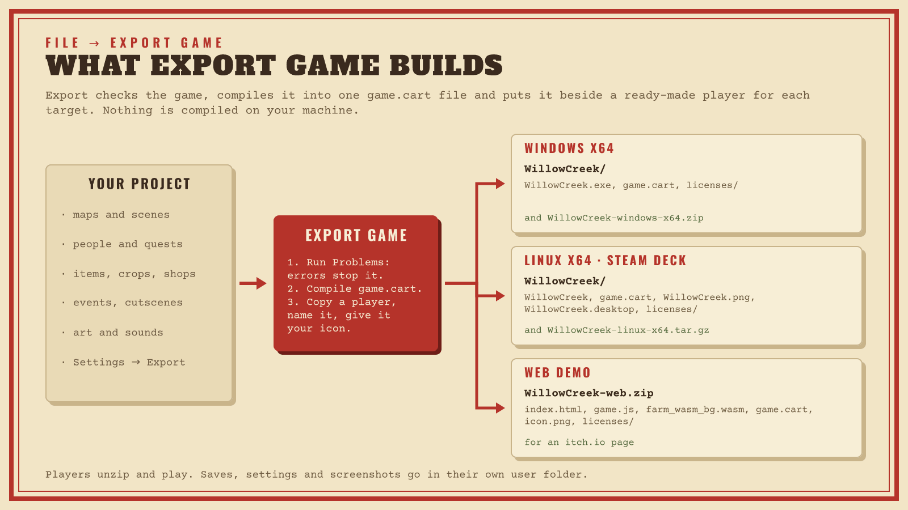

# Export Game

Export Game turns your project into games people can download and play:
a Windows x64 game, a Linux x64 game that also runs on the Steam Deck, and a
web demo for an itch.io page. Players need nothing else: no editor, no
install and no runtime to download.



| Target | What you get | Runs on |
|---|---|---|
| **Windows x64** | A folder with `<Game>.exe`, and a `.zip` | 64-bit Windows; the Steam Deck through Proton |
| **Linux x64** | A folder with the `<Game>` program, and a `.tar.gz` | Most desktop Linux distributions and the Steam Deck |
| **Web demo** | A folder with `index.html`, and a `.zip` for itch.io | Current desktop and mobile browsers, with touch controls on phones and tablets |

A macOS game target is not available yet ([ROADMAP](../ROADMAP.md)).

## Before you export

1. **Fill in Settings → Export** (see [Export settings](#export-settings)).
   At least give the game a title and an icon.
2. **Open the Problems tab.** Errors stop the export; warnings are listed in
   the export report. Fix the errors, and read the warnings about text the
   game's font can't draw if your game is translated.
3. **Playtest once more** in Play Mode. Play Mode runs exactly the game
   Export Game ships.

## Export from the editor

**File → Export Game…** (Ctrl+Shift+E, Cmd+Shift+E on macOS) opens the
export window:

1. Under **Targets**, tick the games to build. The window remembers your
   choice for the project.
2. Choose the **Output folder**. Each target gets a folder of its own inside
   it.
3. Leave **Create archives** ticked to get a ready-to-upload `.zip` (Windows
   and web) or `.tar.gz` (Linux) next to each folder.
4. Click **Export**. The report lists every file written with its size, the
   warnings, and an **Open folder** link per target.

Export works offline: the editor carries a ready-made player for every
target, so nothing is compiled on your machine, and an editor on Windows can
export the Linux game and the other way around.

Exporting again over an earlier export replaces it. Export refuses to write
into a game folder that holds files it didn't write (your notes, say), so a
mistyped output folder loses nothing. If an export fails part-way (a full
disk, the game still running) or you cancel it, the previous export stays as
it was. A failure only affects its own target; the other targets still
export.

## What's in the box

```text
Output folder/
  windows-x64/WillowCreek/
    WillowCreek.exe            the game, with your icon and version
    game.cart                  your game's content, compiled
    licenses/THIRD-PARTY.txt   the notices that must ship with the game
  linux-x64/WillowCreek/
    WillowCreek                the game (executable)
    game.cart
    WillowCreek.png            icon for desktop launchers
    WillowCreek.desktop        launcher entry
    licenses/THIRD-PARTY.txt
  web/WillowCreek/
    index.html, style.css, game.js, farm_wasm.js, farm_wasm_bg.wasm
    game.cart, icon.png, licenses/THIRD-PARTY.txt
  WillowCreek-windows-x64.zip  the Windows folder, under WillowCreek/
  WillowCreek-linux-x64.tar.gz the Linux folder, under WillowCreek/
  WillowCreek-web.zip          the web files at the zip's root (what itch.io expects)
```

`game.cart` holds everything your game is made of, including only the art
and sounds the game uses (the export report lists the assets it left out).
It sits next to the program instead of inside it, so a content update
changes one file and Steam patches stay small.

Keep the `licenses` folder with the game. It lists the open-source software
inside the player and the engine's license; your project's content (maps,
text, art, sounds) stays yours. [LICENSING.md](../LICENSING.md) explains the
terms in plain words.

The same project exported by the same editor version gives the same
`game.cart`, byte for byte, and archives with fixed dates and file order, so
two exports can be compared.

## Export settings

**Settings → Export** holds what the exported game shows. A project that
never saved them exports with the defaults.

| Setting | Example | What it does |
|---|---|---|
| Title | `Willow Creek Farm` | The window title and the title screen. Defaults to the project name. |
| Executable name | `WillowCreek` | The name of the program and its folder: 1–64 letters, digits, `-` or `_`, starting with a letter or digit. Without one, export uses the title. |
| Version | `1.2.0` | Shown on the title screen, written into the Windows program's details and stored in saves. |
| Author, company | | The Windows program's details and the credits. The company also names the Windows save folder. |
| Game id | `local.willow-creek` | Names the folder players' saves go in. The editor makes it once from the project and shows it read-only: it never changes, even when you rename the game, so players' saves keep working. |
| Icon | an image asset | A PNG of at least 256×256 pixels. Export makes the 16–256 pixel icons from it. Without one, the game gets Tractr's default wheat-and-field icon. |
| Window | 1280 × 800 | The window size the game starts with (1280 × 800 by default, the Steam Deck's screen), and whether it starts fullscreen. Players can change both. |
| Pixel scale | `integer` or `fit` | Integer scaling (the default) keeps pixel art crisp in whole steps and letterboxes the rest; fit scales the world to fill the window. Players can change it. |
| Credits | text | Shown on the credits screen. |

## Ship it

### Steam

Upload the Windows and Linux folders as separate depots. The Steam Deck runs
either: the Linux game natively, or the Windows game through Proton. Steam
Cloud can sync the game's save folder with Auto-Cloud (set up on Steam's
side; see [Where saves go](PLAYER.md#saves)), with no SDK in the game.
Steam achievements, the overlay and Steam Input are not supported yet.

### itch.io

Upload the archives with [butler](https://itch.io/docs/butler/) or the
itch.io dashboard. For the web demo, upload `WillowCreek-web.zip` as an
HTML game: itch.io serves the page for you.

### Code signing

Exported Windows games are not signed, so Windows SmartScreen warns players
the first time they run the game until it has a reputation. If you have a
code-signing certificate, sign `<Game>.exe` after exporting: `game.cart` is a
separate file, so signing does not get in its way. Export never signs, and
removes any signature a player template had, because changing the program
(icon and version) would break it.

## The web demo

The web demo runs the same game in a browser: the same player, compiled to
WebAssembly, with the same title screen, saves, settings and game UI.

- **Saves and settings** are kept in the browser's storage for the page, one
  entry per game id. If the storage is full (itch.io pages share one quota),
  the game says progress is not being saved until a later save works.
- **Touch controls** appear on phones and tablets: a D-pad, Interact, Sleep,
  Inventory and Menu. They keep working when a player rebinds keys, and the
  game moves its prompts and panels above them.
- **Testing it yourself:** browsers load WebAssembly only from a web server,
  so opening `index.html` from the disk does not work. Run a small server in
  the folder and open the address it prints:

  ```sh
  cd "Output folder/web/WillowCreek"
  python3 -m http.server 8000
  ```

  then visit <http://localhost:8000>.
- **Security:** the page loads only its own files and runs no inline script
  (it sets a strict Content-Security-Policy), so it is safe to host anywhere.

## Updating a released game

Bump the version in **Settings → Export** and export again. Players keep
their saves: a save from an older version loads in the newer one, items you
removed are kept aside instead of lost, and new NPCs and map changes appear
in their world. A save from a *newer* version loads with a warning.

## Export from the command line

`farmc`, Tractr's command-line compiler, does exactly what the menu command
does, so a build server can export your game on every change. It runs from a
copy of the Tractr source ([build from source](../CONTRIBUTING.md#build-and-test)),
and takes its player templates from the editor's `players` folder or from the
`player-*.zip` / `.tar.gz` files attached to each
[release](https://github.com/JX-Holdings-LLC/tractr/releases):

```sh
dotnet run --project src/FarmEngine.Cli -- export path/to/WillowCreek --target windows-x64 --target linux-x64 --out dist
dotnet run --project src/FarmEngine.Cli -- export path/to/WillowCreek --target web --out dist --no-archive --templates path/to/players
```

`<project>` is a project folder (or its `project.json`) or a single-file
project JSON. Without `--target`, farmc exports the targets the project last
exported. It prints the same report as the editor and exits with 1 when
anything failed, so a CI job fails with it. `farmc compile <project> --out
game.cart` builds only the cartridge. The templates must be the ones of the
same Tractr version: export refuses others.

## When export fails

| Message | What to do |
|---|---|
| The Problems tab has errors | Open Problems, fix each error (**Go to** jumps there) and export again. |
| The player template has no … slot, or the template is for another version | The `players` folder next to the editor doesn't match this editor. Reinstall Tractr (or, from source, run `dotnet build` again). `FARM_PLAYER_TEMPLATES` can point the editor and farmc at another folder. |
| The output folder holds files export didn't write | Choose an empty folder, or the folder of an earlier export. |
| The title or company is too long | The Windows program has room for 200 characters in each detail. Shorten it. |
| The icon is not a PNG, or too small | Use a PNG asset of at least 256×256 pixels. |
| The web demo shows nothing when opened from the disk | Serve it from a web server ([The web demo](#the-web-demo)). |

More in [Troubleshooting](TROUBLESHOOTING.md). How export works inside is in
[Export internals](dev/EXPORT-INTERNALS.md).
