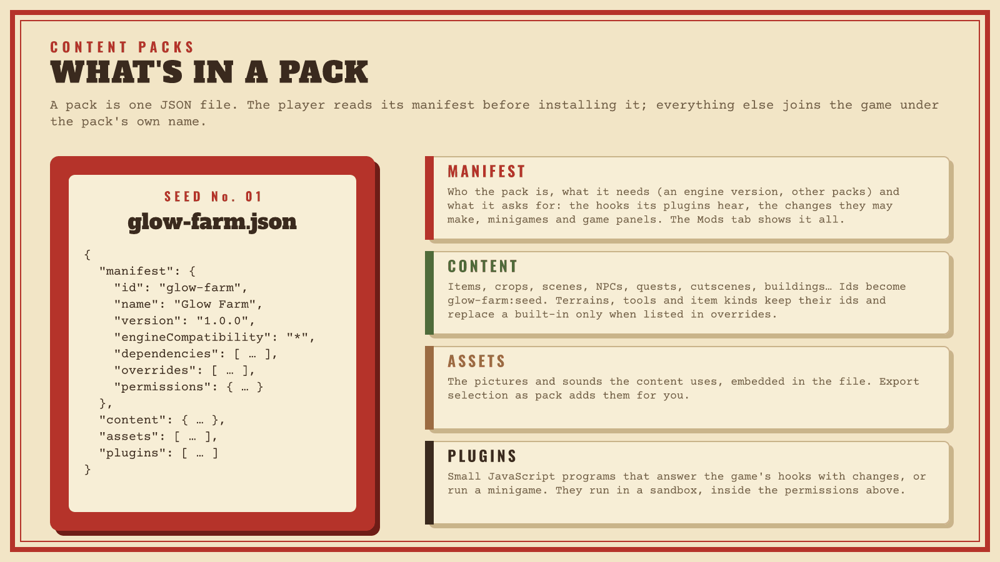

# Content packs

A content pack is a JSON file that adds to a game: new crops, items, people,
scenes, quests, events, buildings, monsters, minigames, game panels, and
small JavaScript programs called [plugins](PLUGINS.md). Creators install
packs in the editor's **Mods** tab, where they can review what a pack
brings before it touches their game. This page is for anyone who makes packs.



## Make your first pack

1. **Start from the template.** In the Mods tab, the **Registry** lists the
   packs that ship with Tractr. Install *My First Mod*, the starter template,
   or save content you already made as a pack: select it under **Export
   selection as pack**, give it a **Pack name** and click **Save pack JSON…**.
   Either way you have a pack file to edit.
2. **Give it an id.** Open the file in a text editor and set
   `manifest.id` (lowercase letters, digits and dashes: `glow-farm`),
   `name`, `version` and a `description`.
3. **Add content.** Each list under `content` takes the same records the
   project uses; the easiest way to get one right is to make it in the
   editor and copy it from **Edit as JSON**:

   ```json
   {
     "manifest": {
       "id": "glow-farm", "name": "Glow Farm", "version": "1.0.0",
       "description": "A crop that glows at night.", "author": "you",
       "engineCompatibility": "*",
       "permissions": { "hooks": [], "contentInject": true }
     },
     "content": {
       "items": [
         { "id": "lucky-coin", "name": "Lucky Coin", "description": "It has to be lucky, right?",
           "type": "material", "stackable": true, "maxStack": 99, "value": 500 }
       ]
     },
     "plugins": []
   }
   ```

4. **Install it.** In a test project, **Choose pack JSON**, read the review
   (what the pack adds, overrides and needs, and what its plugins may do),
   then **Install reviewed pack**.
5. **Try it.** Press F5. Your item is `glow-farm:lucky-coin` in the game: use
   the debug drawer, a shop or an event to get one. Problems lists anything
   in the pack that doesn't fit the game.
6. **Change it.** To load a new version of the file, **Remove** the pack and
   install it again.

Example packs to read: [my-first-mod.json](../fixtures/projects/my-first-mod.json)
(the template), [demo-mod.json](../fixtures/projects/demo-mod.json) (a crop,
a machine, a recipe and a plugin), [county-fair-mod.json](../fixtures/projects/county-fair-mod.json)
(a building, goals, a monster and a game panel) and
[lantern-night-mod.json](../fixtures/projects/lantern-night-mod.json)
(a plugin minigame).

## The pack file

```json
{
  "manifest": { … },
  "content": { … },
  "assets": [ … ],
  "plugins": [ … ]
}
```

### Manifest

| Field | Required | What it is |
|---|---|---|
| `id` | yes | The pack's id: lowercase letters, digits and dashes, starting with a letter or digit. It prefixes the pack's content ids. Never change it after release. |
| `name`, `version` | yes | Shown in the Mods tab. `version` is your pack's own version. |
| `description`, `author` | | Shown in the review and the installed list. |
| `engineCompatibility` | | A version range of the pack format the pack is written for: `*` (any, the default), an exact `0.5.0`, `^0.5.0` or `>=0.5.0`. The pack format is version 0.5.0; a pack that asks for another gets a warning. |
| `dependencies` | | Packs that must be installed and enabled first: `[{ "packId": "base-crops", "version": "^1.0.0" }]`. Dependencies load before the pack; a missing one is a Problems error. |
| `overrides` | | Ids of existing content the pack means to replace (see [Overrides](#overrides)). |
| `permissions` | | What the pack asks for (below). |
| `base` | | `true` only for a pack that is a game's base content: its ids stay plain, without the pack prefix. Leave it out. |

### Permissions

The review shows these to the creator before they install the pack.

| Permission | Default | What it allows |
|---|---|---|
| `contentInject` | `true` | The pack's content (definitions, `playerStart`, string tables) loads. When it is `false`, none of it loads (Problems warns if the pack has content) and its plugins still run. |
| `uiPanels` | `false` | The pack's game panels (`content.gamePanels`) show on the game screen, after the game's own. |
| `hooks` | none | The game events the pack's plugins may hear ([Hooks](PLUGINS.md#hooks)). |
| `mutations` | a few | The changes the plugins may make ([Mutation capabilities](PLUGINS.md#mutation-capabilities)). |
| `minigames` | none | The minigame kinds the plugins may define ([Minigames](PLUGINS.md#minigames)). |

### Content

`content` holds lists of the same records a project has, by the names the
project JSON uses: `crops`, `items`, `recipes`, `machineTypes`, `nodeTypes`,
`animalSpecies`, `fishTables`, `weatherTypes`, `npcs`, `dialogues`, `scenes`,
`events`, `quests`, `shops`, `actions`, `minigames`, `terrains`, `tools`,
`itemCategories`, `cropQualities`, `cropMutations`, `cutscenes`,
`heartEvents`, `buildingTypes`, `collections`, `bundles`, `achievements`,
`mail`, `monsters`, `skills` and `gamePanels`. It can also have:

- `playerStart`: where a new game starts and with what (`sceneId`, `x`, `y`,
  `money`, `inventory`). Base packs use it to be a whole starter game.
- `strings`: text per language, `{ "es": { "key": "texto" } }`.

### Assets

`assets` holds the pictures the pack's content uses, each with an `id` and
its image as a base64 `data:image/…` URL. **Export selection as pack** fills
it for you with the images the exported entries use. When the pack is
installed, its art joins the project's; if the project already has
different art with the same id, the project keeps its own and the review
says so.

### Plugins

`plugins` holds the pack's JavaScript programs: an `id`, the `hooks` and
`minigames` it uses, and its `source`. See [Pack plugins](PLUGINS.md).

## Ids and namespacing

Every id a pack defines gets the pack's id in front: a pack `glow-farm` that
defines the item `seed` adds `glow-farm:seed` to the game. References inside
the pack's content are namespaced the same way, so the pack's recipe can say
`seed` and mean `glow-farm:seed`, with a few rules:

- **Scenes are named in full.** Scene references inside a pack are not
  prefixed: a pack writes `glow-farm:cave` for its own scene. A pack's scenes
  join the world the first time a door or a warp leads there.
- **Vocabulary keeps its ids.** Terrains, tools, item kinds, crop qualities
  and crop mutations keep the ids they were written with (a pack's `lava` is
  painted as `lava`), so they can be shared between packs.
- **Everything else is prefixed**, references included: cutscenes and heart
  events, building types (and a building's upgrade and materials, a builder
  shop's buildings), collections (and their items), bundles, achievements,
  letters (and their attachments), monsters (and their drops), game panels
  (and the items and actions their entries name), skills, and the building,
  bundle, achievement, letter or monster a condition, outcome or event
  trigger names.
- **Flags are named as written.** A panel can show a flag its plugins keep
  as `glow-farm:flag`.

To name content that isn't the pack's own (the game's items, another pack's
content), write its full id: `turnip`, `other-pack:seed`.

## Overrides

A pack replaces a built-in definition, the game's own or an earlier pack's
only when its manifest lists that id in `overrides`. Without it, Problems
warns about the clash and the earlier definition stays. For vocabulary, list
the plain id (`grass`); for other content, the full id.

## Load order

The Mods tab's list is the load order: dependencies first, then packs from
the top down. Reorder with the arrows. A later pack's overrides win over an
earlier one's.

## Packs in exported games

Export Game compiles the enabled packs into the game: their content, art and
plugins ship inside `game.cart`, and players need nothing else. Players can't
install packs into an exported game themselves.

## Importing a pack into a project

**Import into project** turns an installed pack into ordinary project content
the creator can edit. The content keeps its namespaced ids, the pack's
vocabulary, cutscenes and heart events are written into the project, and its
skills join the progression settings.

## Checklist before you share a pack

- The `id` is final and unique (your name in it helps: `jo-glow-farm`).
- `permissions` asks for no more than the pack needs; creators see it.
- It installs into a new Starter Farm project and Problems shows no errors
  from it.
- Plugins answer within their budgets and never throw in normal play
  ([Limits](PLUGINS.md#limits)).
- Packs are your own work: see [LICENSING.md](../LICENSING.md#plugins-packs-and-mods)
  for how they relate to Tractr's license.
