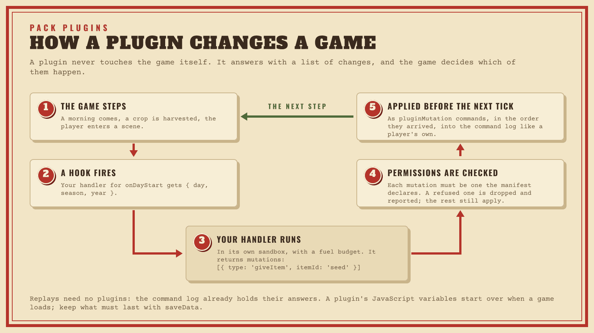
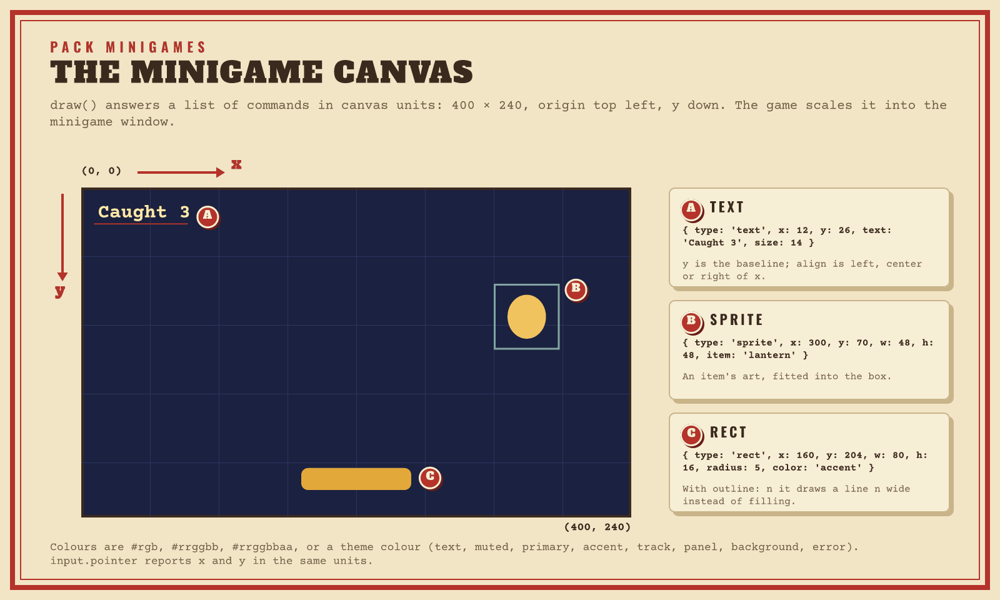

# Pack plugins

A [content pack](PACKS.md) can ship **plugins**: small JavaScript programs
that react to what happens in the game and add systems of their own. A
plugin registers handlers with `api.on(hook, fn)`; a handler gets the hook's
payload as plain JSON and answers with a list of **mutations**, changes such
as `{ type: 'giveMoney', amount: 10 }`. A plugin can also define its own
minigame kinds, which it runs and draws frame by frame
([Minigames](#minigames)).



Plugins never touch the game state themselves. Each answer is checked
against the permissions the player approved and then runs as a command,
like anything the player does, so a recording of a game replays the same
without the plugins. Plugins run in a sandbox (a JavaScript engine compiled
to WebAssembly, one isolated instance per plugin) with deterministic
budgets, the same in the editor's Play Mode, exported games and the web demo.

## Your first plugin

This plugin greets the player each morning and, every seventh day, gives
them a seed of the pack's own.

1. **Start a pack** ([Make your first pack](PACKS.md#make-your-first-pack))
   with an item `seed-glowshroom`.
2. **Ask for what the plugin needs** in the manifest: the hooks it listens to
   and the changes it makes.
3. **Write the plugin.** `source` is the body of a JavaScript function that
   gets `api`; JSON needs the source on one line, so keep longer plugins in a
   `.js` file while you write them and paste them in as a string.

   ```json
   {
     "manifest": {
       "id": "glow-farm", "name": "Glow Farm", "version": "1.0.0",
       "permissions": {
         "hooks": ["onDayStart"],
         "mutations": ["message", "giveItem"]
       }
     },
     "content": { "items": [ … ] },
     "plugins": [{
       "id": "morning-hum",
       "hooks": ["onDayStart"],
       "source": "api.on('onDayStart', p => { var out = [{ type: 'message', text: 'Good morning! Day ' + p.day }]; if (p.day % 7 === 0) out.push({ type: 'giveItem', itemId: 'seed-glowshroom', quantity: 1 }); return out; });"
     }]
   }
   ```

   The same source, laid out:

   ```js
   api.on('onDayStart', p => {
     var out = [{ type: 'message', text: 'Good morning! Day ' + p.day }];
     if (p.day % 7 === 0) out.push({ type: 'giveItem', itemId: 'seed-glowshroom', quantity: 1 });
     return out;
   });
   ```

4. **Install and review** it in the Mods tab: the review lists the hooks and
   changes you asked for.
5. **Playtest** (F5) and sleep (Z) to reach the next morning. The message
   shows as a toast. If something is wrong, the debug drawer's plugin errors
   and an error toast say why ([When a plugin fails](#when-a-plugin-fails)).
6. **Iterate**: remove the pack, edit the file and install it again.

`itemId: 'seed-glowshroom'` means the pack's own `glow-farm:seed-glowshroom`
([Own content](#own-content)). The complete version of this pack is
[demo-mod.json](../fixtures/projects/demo-mod.json).

## How plugins run

- **Handlers** are registered with `api.on(hookName, handler)` when the
  plugin starts. A handler returns an array of mutations, or nothing (`[]`).
  The plugin's top-level code runs once per sandbox instance, so keep it to
  registering handlers and setting up variables.
- **A plugin hears a hook** when the hook is in both its own `hooks` list and
  the manifest's `permissions.hooks`.
- **JavaScript variables last for a session** but are not saved: they start
  over when a game loads, when a playtest restarts and when the plugin is
  restarted after a failure. Keep what must last with
  [saveData](#saved-data).
- **The sandbox has no clock and no outside world**: no files, no network,
  `Date.now()` is always 0 and `Math.random()` gives the same sequence in
  every run ([Determinism](#determinism)).

## Hooks

A plugin hears the hooks in its `hooks` list that the manifest's
`permissions.hooks` also lists. Payloads are plain JSON objects, keys in the
order below.

| Hook | When | Payload |
|---|---|---|
| `onDayStart`, `onDayEnd` | Each morning; each night before it | `{ day, season, year }` |
| `onSeasonChange` | A new season | `{ season, previousSeason, year }` |
| `onYearStart` | A new year | `{ year }` |
| `onTimeOfDay` | The clock reaches a full hour (the hours past midnight count on: 24, 25, …) | `{ hour, day }` |
| `onSceneEnter` | The player is in another scene than before the step: a door, a warp, the mine, fainting, sleeping, an outcome | `{ sceneId, fromSceneId }` |
| `onCropHarvest` | A crop was harvested | `{ cropType, quantity, quality }` |
| `onItemSell` | Items sold at a shop, or from a shipping bin overnight (one per item and quality) | `{ itemId, quantity, money, via, shopId }`: `via` is `shop` (with `shopId`) or `shipping` |
| `onRecipeCraft` | A recipe was crafted | `{ recipeId }` |
| `onFishCatch` | A fish was caught | `{ itemId, fishTableId }` |
| `onResourceGather` | A node broke and dropped items | `{ nodeTypeId, drops: [{ itemId, quantity }] }` |
| `onNPCInteract`, `onGiftGiven`, `onRelationshipChange` | Talking to an NPC, a gift, a friendship change | `{ npcId }`; `{ npcId, itemId, reaction }`; `{ npcId, friendship }` |
| `onBuild` | A building was finished or upgraded | `{ buildingId, sceneId }` |
| `onBundleComplete` | A bundle was completed | `{ bundleId }` |
| `onAchievementUnlock` | An achievement was unlocked | `{ achievementId }` |
| `onMonsterSlay` | A monster was slain | `{ monsterId, sceneId }` |
| `onAction`, `onMinigameResolve` | A creator action ran; a minigame ended | `{ actionId }`; `{ minigameId, score }` |
| `onWeatherRoll` | The night rolled the weather ([Timing](#timing)) | `{ weatherId, day }` |
| `onCommand`, `onEffect` | Every player command; every effect of a step | `{ commandType }`; `{ effectType }` |
| `onLoad` | The game started or was loaded with the plugin attached ([Saved data](#saved-data)) | `{ data }` |

## Mutations

A handler answers with an array of mutation objects, each with a `type`.
Ids are strings and amounts are whole numbers. A mutation outside its ranges
is refused ([When a plugin fails](#when-a-plugin-fails)).

| Mutation | Fields |
|---|---|
| `message` | `text`, at most 500 characters: a toast |
| `playSound` | `soundId`: a built-in sound (`ui`, `coin`, `harvest`, `quest`, `success`, `error`, …) or a sound asset |
| `giveItem`, `takeItem` | `itemId`, `quantity` (1 to 999) |
| `giveMoney`, `takeMoney` | `amount` (1 to 1,000,000) |
| `setFlag` | `flag`, `value`: `true`/`false`, a number or a string (at most 4096 characters) |
| `modifyFriendship` | `npcId`, `delta` (-1000 to 1000) |
| `grantXp` | `skill`, `amount` (1 to 10,000) |
| `modifyEnergy` | `delta`, whole energy points (-1000 to 1000) |
| `setWeather` | `weatherId`: today's weather |
| `startQuest` | `questId` |
| `warpPlayer` | `sceneId`, `x`, `y`: a tile (a blocked or off-map tile lands on the nearest walkable one) |
| `startDialogue` | `npcId`, `dialogueId` (optional) |
| `performAction` | `actionId`: run a creator action |
| `startMinigame` | `minigameId` |
| `saveData` | `data`: see [Saved data](#saved-data) |

These run the event outcome of the same name ([Event
logic](CREATOR-GUIDE.md#event-logic)), with its meaning: an unknown id does
nothing, a node or machine goes only on a free tile, and so on. Coordinates
are tiles (0 to 511); a `sceneId` left out means the scene the NPC is in
(`moveNpc`) or the player's (the tile mutations).

| Mutation | Fields |
|---|---|
| `moveNpc` | `npcId`, `sceneId` (optional), `x`, `y` |
| `startCutscene` | `cutsceneId` |
| `setVariable` | `variable`, `value`: a number (at most 1e9 either way) or a string (at most 4096 characters). `true`/`false` is `setFlag`. |
| `addVariable` | `variable`, `amount`: -1,000,000 to 1,000,000 |
| `addShopStock` | `shopId`, `itemId`, `price` (optional, whole gold, 0 to 1,000,000; absent: the item's price), `dailyLimit` (optional, 1 to 999) |
| `removeShopStock` | `shopId`, `itemId` |
| `placeNode` / `removeNode` | `sceneId` (optional), `x`, `y`; `nodeTypeId` for `placeNode` |
| `placeMachine` / `removeMachine` | `sceneId` (optional), `x`, `y`; `machineTypeId` for `placeMachine` |
| `setRelationship` | `npcId`, `status`: `single`, `dating`, `engaged` or `married` |
| `sendMail` | `mailId`: the letter arrives the next morning |
| `modifyHealth` | `delta`: -1000 to 1000 (with combat on) |
| `setInventorySize`, `addInventorySize` | `amount`: -1000 to 1000 backpack slots, within the game's progression limits; an occupied slot is never taken away |
| `addMaxEnergy`, `addMaxHealth` | `amount`: -1000 to 1000 points, within the game's progression limits |
| `applyBuff` | `buff`: `id`, `stat`, `amount` (-1000 to 1000), `durationMinutes` (1 to 525,600), and optionally `icon`, `persistsAfterSleep` and `additive`; at most 2048 bytes. Reusing an id restarts that buff. At most 64 buffs are active. |

Variables count toward the plugin's 256 different flags per session.

## Permissions

The manifest's `permissions` are what the player approves when installing
the pack ([Permissions](PACKS.md#permissions) has the whole list). For
plugins, three matter:

- `hooks`: the hooks the pack's plugins may hear.
- `mutations`: the changes they may answer with (below).
- `minigames`: the minigame kinds they may define ([Minigames](#minigames)).

### Mutation capabilities

Each entry of `permissions.mutations` allows one mutation type:

| Entry | Allows |
|---|---|
| `"message"`, `"playSound"` | Messages and sounds. |
| `"giveMoney"`, `"takeMoney"`, `"modifyEnergy"`, `"grantXp"`, `"setWeather"`, `"modifyHealth"`, `"setInventorySize"`, `"addInventorySize"`, `"addMaxEnergy"`, `"addMaxHealth"` | That change, with any value its fields allow. |
| `"setFlag"`, `"giveItem"`, `"takeItem"`, `"modifyFriendship"`, `"startQuest"`, `"warpPlayer"`, `"startDialogue"`, `"performAction"`, `"startMinigame"`, `"moveNpc"`, `"startCutscene"`, `"setVariable"`, `"addVariable"`, `"addShopStock"`, `"removeShopStock"`, `"placeNode"`, `"removeNode"`, `"placeMachine"`, `"removeMachine"`, `"setRelationship"`, `"sendMail"`, `"applyBuff"` | That change, for the pack's **own** content only (below). `"giveItem:own"` means the same. |
| `"giveItem:any"` (any of the types above with `:any`) | That change for any id: the game's content, base content and other packs. |
| `"*"` | Everything, with any ids. |

Ask for as little as the plugin needs: creators read the list before they
install, and a pack asking for `"*"` is a harder sell.

### Own content

For the types that name content, a plain id means the
plugin's own pack: `setFlag` with `flag: 'met'` from pack `glow-farm` sets
the flag `glow-farm:met`, and `giveItem` with `itemId: 'seed'` gives
`glow-farm:seed`. Ids already written as `glow-farm:…` are kept. Ids of
other packs (`other-pack:seed`) are refused unless the pack has `type:any`;
so is the game's own content, because a plain id always means the pack's.
With `:any`, ids are used exactly as written. A base pack's own definitions keep plain ids, so its plugins need
`:any` to name them.

**Without `permissions.mutations`** the plugins get `message`, `playSound`,
`setFlag`, `giveItem` and `takeItem` for their own content, and their answers to `onEffect` and `onCommand` are
dropped: those hooks are for watching unless the pack declares what its
plugins do.

**Never allowed:** flags (and variables, which are flags) starting with
`event:`. The engine keeps one-shot events there (`event:<id>:fired`), so a
plugin could re-arm or switch off the game's events.

**Always allowed:** `saveData` ([Saved data](#saved-data)): it keeps only the
plugin's own data.

## Saved data

A plugin can run a system of its own across saves: its JavaScript
variables start over whenever the game loads, but what it answers with
`saveData` is kept in the save.

```js
var visits = 0;
api.on('onLoad', p => { visits = p.data ? p.data.visits : 0; return []; });
api.on('onSceneEnter', p => {
  visits++;
  return [{ type: 'saveData', data: { visits: visits } }, { type: 'message', text: 'Visit ' + visits }];
});
```

- `{ type: 'saveData', data }` keeps `data` (any JSON, at most 16 KiB as
  compact text) as the plugin's saved data, replacing what it saved before.
  It needs no capability: it touches nothing but the plugin's own data.
- `onLoad` is heard by each plugin alone, with `{ data }`: what it saved in
  this game, or `null`. It comes when a new game starts and when a save
  loads (and when Play Mode starts a playtest, whose **Keep changes**
  carries the data into the next one), before any other hook.
  Answers to it apply before the first tick like any other. A plugin rebuilt
  after a strike (its JavaScript state starts over) hears it again before
  the next tick, with what it has saved up to then.
- The saved data is part of the game state, so it is in the command log and
  replays the same; a plugin's data stays when its pack is turned off and
  comes back with it.

## Game panels

A pack with `permissions.uiPanels` can add game panels, the same panels the
editor's Interface tab makes: a title, an optional flag that must be set
before the panel shows, and entries (`text`, `money`, `energy`, `day`, an
`item` count, a `flag` or an `action` button).

```json
"content": {
  "gamePanels": [{
    "id": "fair-board", "title": "County Fair",
    "entries": [
      { "label": "Ribbons", "kind": "item", "value": "ribbon" },
      { "label": "Barn raised", "kind": "flag", "value": "county-fair:barn-raised" }
    ]
  }]
}
```

Panel ids are namespaced (`county-fair:fair-board`), and so are the items and
actions entries name when the pack defines them. Flags are named as written:
a plugin's own flags are `packId:flag`, so a panel can show what the pack's
plugins keep there. The game shows the panels of its enabled packs, in load
order, after its own. [county-fair-mod.json](../fixtures/projects/county-fair-mod.json)
is an example pack with a panel.

## Timing

- **Answers apply before the next tick.** A handler runs right after the step
  that fired its hook (a tick, a player command, another plugin's mutation).
  Its mutations wait in a queue and run right before the next tick, in the
  order they arrived. The game advances one tick at a time, so this does not
  depend on the frame rate: the same input gives the same game at 30 and at
  144 frames per second.
- **Chains stop.** A step caused by a plugin mutation does not fire
  `onCommand` or `onEffect`, and mutations three reactions deep are dropped
  (a plugin answering a mutation's hook, another answering that, and so on).
  A plugin cannot make the game loop on itself.
- **`onWeatherRoll` is a notification.** The engine lets the weather roll be
  overridden while the night runs, but plugins answer only after the step.
  A `setWeather` answer changes the weather for the day, yet the night's rain
  watering and storm damage already used the rolled weather. The Problems
  panel warns about plugins that listen to `onWeatherRoll`.

## Minigames

A pack can bring its own minigame kinds. A plugin defines one with
`api.minigame(name, { start, update, draw })`; the game runs it while a
minigame of that kind is open, one `update` and one `draw` per frame, and
draws what `draw` answers inside the minigame window. `update` reads the
game keys and the mouse or touch over the window, and can ask for sounds.
When `update` says the game is done, its score resolves the minigame exactly
like a built-in kind's: the def's result tiers give the rewards, and only the
score enters the command log, so replays need no plugins.

```json
{
  "manifest": {
    "id": "lantern-night", "name": "Lantern Night", "version": "1.0.0",
    "permissions": { "minigames": ["lantern-catch"] }
  },
  "content": {
    "minigames": [{
      "id": "catch", "name": "Lantern Catch", "kind": "lantern-night:lantern-catch",
      "config": { "lanterns": 6 },
      "resultTiers": [
        { "minScore": 0, "outcomes": [{ "type": "message", "message": "The lanterns drift away." }] },
        { "minScore": 1, "outcomes": [{ "type": "giveItem", "itemId": "lantern", "itemQuantity": 3 }] }
      ]
    }]
  },
  "plugins": [{
    "id": "lantern-catch",
    "minigames": ["lantern-catch"],
    "source": "api.minigame('lantern-catch', { start: (config, info) => ({ x: info.width / 2, caught: 0, t: 0 }), update: (s, input, dt) => { if (input.left) s.x -= 200 * dt; if (input.right) s.x += 200 * dt; s.t += dt; return s.t > 10 ? { state: s, done: { score: s.caught / 6 } } : { state: s }; }, draw: s => [{ type: 'rect', x: 0, y: 0, w: 400, h: 240, color: '#1b2140' }, { type: 'rect', x: s.x - 40, y: 204, w: 80, h: 16, radius: 5, color: 'primary' }, { type: 'text', x: 12, y: 26, text: 'Caught ' + s.caught, color: '#ffe9a8' }] });"
  }]
}
```

The complete example, with falling lanterns and item art, is
[fixtures/projects/lantern-night-mod.json](../fixtures/projects/lantern-night-mod.json).

**Kinds.** A kind is `packId:name`, and its name follows the pack id rule
(lowercase letters, digits and dashes). The plugin's `minigames` and the
manifest's `permissions.minigames` list the name (`packId:name` works too);
only kinds in both are defined, and only while the pack is enabled. Any
minigame def, the game's own or a pack's, can use the kind. The editor's
kind list offers the kinds of the enabled packs, and Problems warns when a
def uses a kind whose pack is not installed, turned off, lacks the
permission or has no plugin defining it (the def then plays as the neutral
"Go!" button, like any unknown kind).

**The functions.** The game keeps the state; the functions get it and answer
a new one:

| Function | Gets | Answers |
|---|---|---|
| `start(config, info)` | The def's `config`; `info` is `{ width: 400, height: 240, seed }`. | The first state (any JSON). Optional: without it the state starts as `null`. |
| `update(state, input, dt)` | The state, the player's input this frame, the frame time in seconds (at most 0.25). | `{ state, done, sounds }`: the new state (the old one stays when `state` is left out); `done: { score }` (0 to 1) or `done: { success }` (`true` scores 1, `false` 0) to finish; `sounds`, a list of sound ids to play this frame. |
| `draw(state)` | The state `update` just answered. | The frame: a list of draw commands. |

`input` is `{ up, down, left, right, action, actionPressed, actionReleased,
pointer }`. The first seven are `true` or `false`, from the game's input
bindings after rebinding: the move keys, arrows, left stick and D-pad, and
Interact (E, Space, Enter, gamepad A, the touch controls' A) as the action.
Escape and the window's Give up button cancel the minigame as usual.

`pointer` is the mouse or a finger over the minigame's canvas:
`{ x, y, down, pressed, released }`, with `x` and `y` in the same
coordinates `draw` uses (0–400, 0–240), `down` while the button or finger is
down, and `pressed` / `released` when it went down or up this frame. A tap
within one frame is both. It is `null` while the pointer is elsewhere (and
on a gamepad or keyboard). A press outside the canvas never reaches the
minigame. One that went down on it is reported until it is let go, wherever
it moves: off the canvas, it stays on the canvas's edge. The game reports the pointer once per frame, so
`update` sees it one frame after the window drew under it.

```js
api.minigame('pop-the-lantern', {
  start: () => ({ x: 200, y: 120, popped: 0 }),
  update: (s, input) => {
    var p = input.pointer;
    if (p && p.pressed && Math.abs(p.x - s.x) < 20 && Math.abs(p.y - s.y) < 20) {
      s.popped++;
      return s.popped >= 5 ? { state: s, done: { success: true }, sounds: ['quest'] } : { state: s, sounds: ['coin'] };
    }
    return { state: s };
  },
  draw: s => [{ type: 'rect', x: s.x - 20, y: s.y - 20, w: 40, h: 40, radius: 20, color: 'accent' }],
});
```

**Sounds** in `sounds` play exactly like a `playSound` outcome's sound id
(the built-in cues `ui`, `coin`, `harvest`, `quest`, `success`, `error`, …,
and any other id `playSound` can play), at the player's sound-effect
volume. They are cosmetic, like the frames: they need no mutation permission
and never enter the command log. An id the game does not know plays nothing.



**Draw commands** use minigame coordinates: the canvas is 400 × 240, origin
top left, `y` down, scaled into the window and clipped to it.

| Command | Fields |
|---|---|
| `{ type: 'rect', x, y, w, h, color, radius, outline }` | A filled rectangle with rounded corners of `radius`; `outline` draws a stroke of that width instead. |
| `{ type: 'text', x, y, text, size, color, align, bold }` | One line of text; `y` is its baseline, `align` is `left`, `center` or `right` of `x`, `size` 6–64 (default 14). |
| `{ type: 'sprite', x, y, w, h, item }` | An item's art fitted into the rectangle. A plain id means the pack's own item (`packId:item`) when there is one, else the id as written. |

Colors are `#rgb`, `#rrggbb`, `#rrggbbaa` or a theme color (`text`,
`muted`, `primary`, `accent`, `track`, `panel`, `background`, `error`), so a
minigame can match the game's interface. Unknown types and keys, a wrong
value or a list over the limits is an error, not ignored.

**Failing.** A minigame whose plugin throws, runs out of fuel or memory,
answers something malformed or breaks a limit ends at once as failed: it
resolves with score 0 (the lowest tier applies), and the error shows in the
plugin errors list and as an error toast, for example
`lantern-night:lantern-catch: [threw] minigame lantern-night:lantern-catch failed: threw in update: s.lantern is undefined`.
The game itself never stops or slows past one frame's budget.

**Isolation.** Each minigame session gets its own sandbox instance of the
plugin, started from its source and granted only that minigame. Its
JavaScript variables start over for every session and never mix with the
plugin's hook handlers, which run in their own instance; the hook budgets,
strikes and windows do not count minigame frames. The plugin's top-level code
runs in both instances, so keep it to registering handlers.

## Limits

Budgets are counted in **fuel**: one unit per WebAssembly instruction the
plugin's JavaScript engine runs (about 0.5–1.3 billion a second in a release
build). They never depend on the machine.

| Limit | Default | When it is hit |
|---|---|---|
| Fuel per handler call | 50 million (40–110 ms) | The call stops; a strike. |
| Fuel per plugin per second of game time | 200 million | The plugin is skipped until the next second; a strike. |
| JavaScript heap / linear memory per plugin | 16 MB / 40 MiB | The call stops; a strike. |
| Recursion | a few thousand JavaScript calls deep | The call stops; a strike. |
| Strikes | 3 within 100 calls of the plugin | The plugin is off for the session. |
| Restarts after a strike | 10 per session | The plugin is off for the session. |
| Startup fuel per plugin / all plugins | 500 million / 2 billion | The plugin does not start. |
| Plugins | 32 | Later plugins do not start. |
| Memory of all plugins at startup | 512 MiB | Later plugins do not start. |
| Mutations per answer | 64 | The rest are dropped. |
| Ids, flag names and skills | 256 characters | The mutation is dropped. |
| String flag values / messages | 4096 / 500 characters | The mutation is dropped. |
| Different flags / skills per plugin per session | 256 / 32 | Further new ones are dropped. |
| An answer's size | 1 MiB | The answer is dropped (like a throw). |
| An error message | 1 KB | The rest is cut off. |
| Minigame start (compile, `start`, first `draw`) | 200 million fuel | The minigame fails. |
| Minigame frame (`update` and `draw`) | 10 million fuel (8–20 ms) | The minigame fails. |
| Minigame state | 16 KiB as JSON | The minigame fails. |
| Draw commands per frame | 256 | The minigame fails. |
| Text per draw command / per frame | 200 / 4000 characters | The minigame fails. |
| Minigame answer (`update` and `draw` together) | 1 MiB | The minigame fails. |
| Sounds per `update` | 8, each id at most 256 characters | The minigame fails. |

A handler that throws gives no mutations and is not a strike, but the fuel it
burned counts toward its per-second budget. After a strike the plugin is
rebuilt from its source (its JavaScript variables start over) with at most
twice the fuel its first start used.

## Determinism

- Budgets and timeouts are counted in instructions, so whether a handler
  finishes is the same on every machine and in every build.
- `Date.now()` is always 0, and `Math.random()` gives the same sequence in
  every plugin and every run.
- A minigame session depends only on its start and its input: the same
  config, seed and input (keys and pointer) give the same states, frames,
  sounds and score on every machine (its `Math.random()` starts the same way
  in every session; use `info.seed` for variety). The seed comes from the game's cosmetic
  randomness, and only the score enters the command log.
- Passing the state into the sandbox and back costs about 260 fuel per byte
  each frame, so a 16 KiB state uses about 4 of a frame's 10 million. Keep
  states small.
- Plugin JavaScript state (variables kept between calls) is not saved. It
  starts over when the game loads, when Play Mode restarts, and when the
  plugin is rebuilt after a strike, so a plugin's answers can depend on the
  session's history; what must last goes in `saveData` and comes back in
  `onLoad` ([Saved data](#saved-data)), also after a rebuild: a plugin
  rebuilt after a strike hears `onLoad` again before the next tick, with
  the data it has saved so far. Replays are not affected: the command log,
  with the plugins' answers in it, is the replay.
- In the web demo the same fuel takes longer than on the desktop (the
  sandbox runs inside the browser's WebAssembly), but a handler finishes or
  fails the same way in both.

## When a plugin fails

Nothing a plugin does can stop or slow the game past its budgets. When
something goes wrong, the plugin's errors list (the debug drawer in Play
Mode, error toasts in the game) says what and why:

| What happened | What the game does |
|---|---|
| A mutation is malformed, out of range or not permitted | That mutation is dropped; the others in the same answer still apply. |
| `permissions.mutations` has an entry the game doesn't know | It is ignored, and Problems warns. |
| A handler throws | It gives no mutations this time. Not a strike. |
| A handler runs out of fuel or memory, or recurses too deep | The call stops: a strike. |
| Three strikes within 100 calls | The plugin is off for the rest of the session. |
| A minigame throws, runs out of fuel or answers something malformed | The minigame ends as failed with score 0. |

After a strike the plugin restarts from its source, so its variables start
over and it hears `onLoad` again with what it saved. The limits are in
[Limits](#limits).

Common causes:

- **Nothing happens.** The hook is missing from the manifest's
  `permissions.hooks` or the plugin's `hooks` (it needs both), or the
  mutation type is missing from `permissions.mutations`.
- **"not permitted" on an id.** A plain id means the pack's own content; to
  give the game's own `turnip`, ask for `"giveItem:any"`.
- **A change a step late.** Answers apply before the *next* tick
  ([Timing](#timing)); `onWeatherRoll` answers come after the night's
  watering.

How the sandbox is built and hardened is in
[Plugin sandbox internals](dev/PLUGIN-SANDBOX.md).
