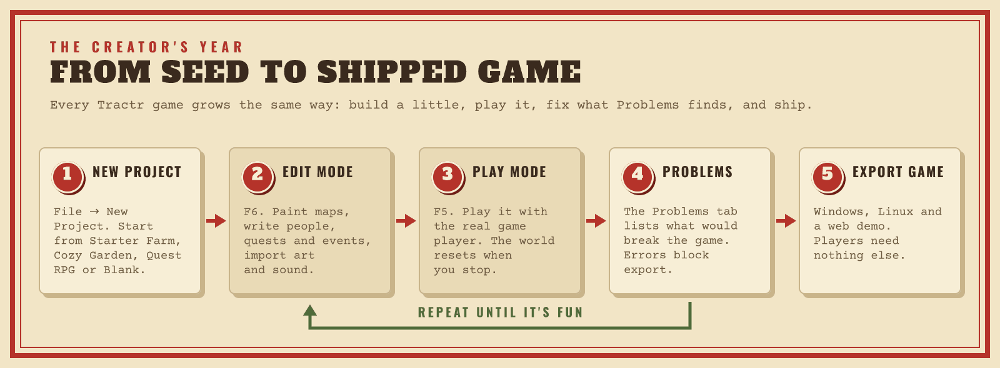

# The Tractr handbook

Everything you need to plant a game, from the first project to the last
export. Pick the shelf that matches what you are doing.

## Making games

For creators: no code needed.

| Page | Read it when you want to… |
|---|---|
| [Install and update](INSTALL.md) | install Tractr on Windows, Linux or macOS, keep it up to date, and find your files |
| [Creator guide](CREATOR-GUIDE.md) | build a game: maps, people, quests, events, the farm, sound, art and every Edit Mode tab. The editor shows it under **Help → Creator Guide** (F1) |
| [Export Game](EXPORT.md) | ship your game for Windows, Linux, the Steam Deck and the web, on Steam or itch.io |
| [The game player](PLAYER.md) | know what your players get: controls, settings, saves, screenshots, crash logs and command-line options |
| [Troubleshooting](TROUBLESHOOTING.md) | fix something that doesn't work |

## Making packs and plugins

For modders and creators who want to extend games with data and JavaScript.

| Page | Read it when you want to… |
|---|---|
| [Content packs](PACKS.md) | make a pack: the file format, ids and namespacing, overrides and load order |
| [Pack plugins](PLUGINS.md) | write plugins: hooks, mutations, permissions, saved data, game panels, minigames and limits |
| [Licensing](../LICENSING.md#plugins-packs-and-mods) | know how packs and plugins relate to Tractr's license (they are your own work) |

## Working on Tractr

For people changing Tractr itself: the [contributor handbook](dev/README.md)
covers the architecture, conventions, numerics, the editor's views, export
and player internals, the plugin sandbox, image safety and releasing.
[CONTRIBUTING.md](../CONTRIBUTING.md) has the build and test commands, and
[ROADMAP.md](../ROADMAP.md) what is planned.

## The look

- [Brand](brand/README.md): the Seed Catalog logos, illustrations and the
  Vixl build kit that draws the pictures in these pages.
- [Style guide](brand/STYLE.md): voice, colour, type, motifs and logo use.
- [How the editor builds it](brand/APP-UI.md): theme tokens, fonts and the
  few places it departs from the guide.

The look is for Tractr itself: the editor, the installer and these pages.
The games you make keep their own.
