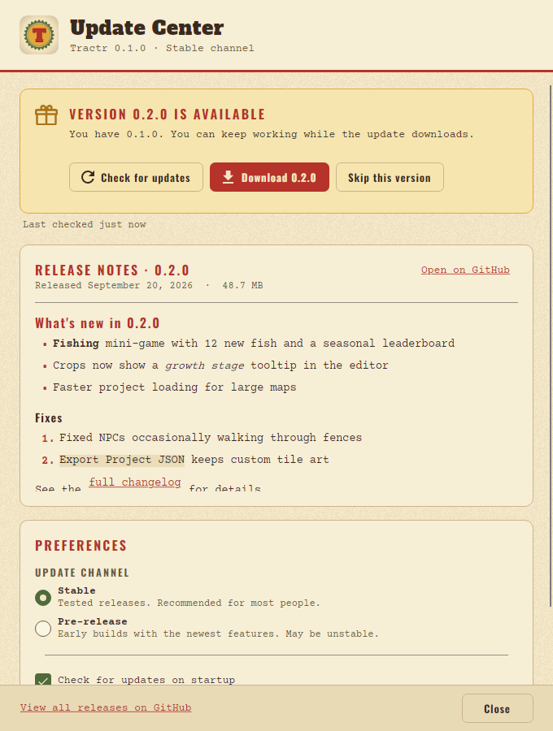

# Releasing Tractr

Windows releases are built by GitHub Actions, packaged with
[Velopack](https://velopack.io) and published as GitHub Releases of
`jxburros/farm-game-engine-native`. The in-app **Update Center**
(Help → Update Center…) reads those releases, so publishing a release is all
it takes to ship an update.

```text
Actions → Release → Run workflow (main, channel, dry run)
                 ──► .github/workflows/release.yml
                     plan          release.json version not published yet on this channel?
                     version       on main? versions agree?
                     player-*      templates (Windows, Steam Runtime Linux, web)
                     smoke-linux   export + replay on the release Linux template
                     release       dotnet test, dotnet publish -p:Version=0.3.1,
                                   export + replay on the release Windows template,
                                   vpk download/pack, SHA256SUMS      (read-only token)
                     publish       [environment "release"] attest, stage the bundle
                     finish        verify the complete bundle; unless dry run:
                                   [environment "release"] tag, draft, upload, check
                                   digests, publish        (shared release-infrastructure)
                                   │
installed app ◄── Update Center ◄──┘  (Velopack GithubSource + GitHub releases API)
```



## Cutting a release

Versions are [SemVer](https://semver.org). The tag is `v` + version, and
`release.json` holds the version the workflow releases.

| Kind        | Example tag       | Channel   | GitHub Release | Offered to               |
|-------------|-------------------|-----------|----------------|--------------------------|
| Stable      | `v0.2.0`          | `stable`  | normal         | Stable + Pre-release     |
| Pre-release | `v0.3.0-beta.1`   | `preview` | pre-release    | Pre-release channel only |

Anything with a `-suffix` is a pre-release and goes out on the `preview`
channel; the plan job fails, saying why, when the channel does not match the
version.

**Every change to `main` advances the version** (`.release/config.json`
`bumpPolicy`, checked by `release-validation.yml`), so `main` always carries
a real version. **Nothing is released until you dispatch it.** Versions you
never dispatch are simply skipped; the next release's notes include theirs.

1. In every pull request, bump the version: with the toolkit pinned in
   `.release/README.md` checked out at `.toolkit`, run
   `node .toolkit/src/release.mjs bump --app farming-rpg-maker` (a patch;
   `--kind minor` or `--version 0.4.0-beta.1` for others). It sets
   `release.json`, `version` in the root `Cargo.toml` and the default
   `<Version>` in `Directory.Build.props`, and adds a `## X.Y.Z` section at
   the top of `CHANGELOG.md` with a `DESCRIBE_CHANGES` placeholder. Run
   `cargo check` so `Cargo.lock` follows, and replace the placeholder with the
   change. `tools/release/versions.sh` checks that they agree; CI runs it.
2. Merge it to `main` once CI is green on the pull request (branch protection
   requires it; CI runs on pull requests, not on every push).
3. When you want to release the version on `main`, run the **Release**
   workflow (Actions → Release → Run workflow) on `main` with the channel that
   matches the version and **dry run** checked. It builds, packs and verifies
   the complete bundle without creating a tag or release.
4. Run it again with **dry run** unchecked. When the build is done, the
   publish jobs wait for a reviewer to approve the `release` environment; the
   final job creates the tag `vX.Y.Z` on the planned commit, uploads every
   file to a draft, checks GitHub's digests, then publishes it.

The release notes are the `CHANGELOG.md` sections of every version after the
latest published release, newest first. They are the GitHub Release body and
are embedded in the Velopack package (`vpk pack --releaseNotes`), so the
Update Center shows them. The plan fails while any of those sections still
holds the placeholder.

A version is released once. The plan skips a version that is already
published, and the publisher never replaces a published release or moves a
tag: installed apps would see different bytes under the same version. If a
publish fails half-way, run the workflow again on the same commit; it resumes
the draft bound to that commit. Release a new version for anything else.

### What the workflow produces

Assets attached to the GitHub Release (Velopack's default `win` channel):

| File                                   | Purpose                                                              |
|----------------------------------------|----------------------------------------------------------------------|
| `Tractr-win-Setup.exe`        | Installer for new users. Installs per-user to `%LocalAppData%\Tractr`, adds Start-menu and desktop shortcuts, no admin rights needed. |
| `Tractr-win-Portable.zip`     | Portable copy (unzip and run; still self-updates).                   |
| `Tractr-X.Y.Z-full.nupkg`     | Full update package.                                                 |
| `Tractr-X.Y.Z-delta.nupkg`    | Delta from the previous release (small download). Only when a previous release exists. |
| `releases.win.json`, `assets.win.json` | Update feed read by the app.                                         |
| `RELEASES`                             | Legacy (Squirrel-compatible) feed.                                   |
| `player-windows-x64.zip`, `player-linux-x64.tar.gz`, `player-web.tar.gz` | Export Game player templates for this version (docs/EXPORT.md). The installer already ships them in `players/`. |
| `SHA256SUMS`                           | SHA-256 of this version's installer, packages, feeds and templates. |
| `build-info.txt`                       | Commit, .NET SDK, rustc and vpk versions and the runner image the release was built with. |

Everything `publish` uploads is kept as a workflow artifact
(`release-bundle-X.Y.Z`, 30 days) for debugging.

The player templates are built first, in their own jobs: `windows-x64` on the
Windows runner (with the placeholder icon and version resources),
`linux-x64` in the Steam Runtime 3 "sniper" SDK container and `web` with
wasm-bindgen. Their `template.json` carries the release version, which must
equal the app's. Before anything is packed, a sample game is exported with
each desktop template the release ships and replayed headless
(`tools/release/smoke-export.sh`): the exported game must report the same run
as its template, and the Windows and Linux templates the same run as each
other.

### How a release is protected

- **Only `main`, only green, only once.** Branch protection on `main` lets a
  pull request merge only when it is up to date with `main` and CI passed on
  it, so every commit on `main` passed CI as it is. The `plan` job only runs on
  `main` and selects the version only if it is not published yet; the
  `version` job checks that the commit is on `main` and that the repository is
  at the release version, before anything is built. The release jobs then run
  the .NET tests, smoke-test exports with each template and check the
  binaries' imports themselves.
- **Branch protection.** Settings → Rules → Rulesets → New branch ruleset,
  targeting the default branch, with **Require a pull request before
  merging** (0 required approvals lets you merge your own), **Require status
  checks to pass** with **Require branches to be
  up to date before merging** checked, and these required checks: `Markdown
  lint`, `Rust (fmt, clippy, test, wasm) (ubuntu-latest)`, `Rust (fmt, clippy,
  test, wasm) (windows-latest)`, `Build & test (Linux)`, `Build, test &
  publish smoke (Windows)`, `Rust coverage`, `Plugin guest (rebuild, fmt,
  clippy, meter tests)`, `Player template (linux-x64, Steam Runtime sniper)`,
  `Dependency audit / Dependency audit` and `versions / validate`. Also
  **Block force pushes** and **Restrict deletions**.
- **Least privilege.** The workflow token is read-only in every job that
  builds or tests (they compile hundreds of crates and run NuGet build
  targets), and no checkout keeps credentials. Only the shared `finish`
  publish job can write. It runs only the pinned release-infrastructure code,
  on the bundle the earlier jobs built and staged.
- **Approval.** The `publish` jobs run in the `release` environment. In the
  repository settings (Settings → Environments → `release`), add required
  reviewers and restrict deployments to the `main` branch (the workflow is
  dispatched there; a tag-only rule blocks it). A tag ruleset (Settings →
  Rules → Rulesets) that limits who creates `v*` tags must let GitHub Actions
  bypass it, since the publisher creates the tag. Without the environment
  settings GitHub creates an unprotected `release` environment and the jobs
  run without approval.
- **Pinned inputs.** Actions are pinned to commit SHAs (with the version in a
  comment; Dependabot bumps them), the Steam Runtime SDK image to a digest,
  `rustup-init` to a checksum (`tools/ci/install-rust.sh`), the .NET SDK to
  `global.json`'s version (CI turns off its roll-forward), Rust to
  `rust-toolchain.toml`, and every cargo build that ships uses `--locked`.
- **Checksums and provenance.** `SHA256SUMS` lists every published file, and
  GitHub's build provenance attestation covers them. To check a download:
  `sha256sum --check --ignore-missing SHA256SUMS`, or
  `gh attestation verify Tractr-win-Setup.exe --repo jxburros/farm-game-engine-native`.
- **Reproducibility.** .NET release builds set `ContinuousIntegrationBuild`
  (source paths become `/_/`), cargo builds map the runner's paths away
  (`--remap-path-prefix`) and ship without debug info, so no runner path ends
  up in a binary. Zip and nupkg bytes still depend on the runtime's zlib;
  `build-info.txt` records the SDK and toolchains of each release.

### Versions in builds

`release.json`, the Cargo workspace (`Cargo.toml`) and `Directory.Build.props`
carry the same version, the one the latest change to `main` advanced to. The
release workflow also passes `-p:Version=X.Y.Z`, which stamps both
`Tractr.exe` and `Tractr.Updates.dll` and marks them as a
release build; `vpk pack --packVersion` uses the same value. Other builds
(`dotnet run`, CI) are development builds: their Help links open the docs on
`main`, since their version may never get a tag.
Crash logs, `fe_version` and the web player's `version()` report the Cargo
version.

The `vpk` tool version is pinned in `release.yml` (`VPK_VERSION`) and **must
match** the `Velopack` package version in `Directory.Packages.props` (currently
`1.2.158`); `tools/release/versions.sh` fails CI until both are bumped
together.

### Dependencies

Dependabot (`.github/dependabot.yml`) opens weekly pull requests for the
Cargo crates, the NuGet packages (Avalonia, SkiaSharp and Svg.Skia move
together), the .NET SDK in `global.json` and the pinned actions. The
**Dependency audit** workflow (`audit.yml`, run by CI and weekly) fails on a
RustSec advisory (`cargo deny`, configured in `deny.toml`, over `Cargo.lock`
and the plugin guest's and meter's lock files), on a vulnerable NuGet package
(`tools/ci/dotnet-vulnerable.py`) and on an unused Cargo dependency
(`cargo machete`).

## How the Update Center finds updates

- `VelopackUpdateService` creates
  `new UpdateManager(new GithubSource("https://github.com/jxburros/farm-game-engine-native", accessToken: null, prerelease: channel == Prerelease))`.
  The **Stable** channel only looks at normal releases; **Pre-release** also
  considers pre-releases. Velopack never offers an older version, so switching
  from Pre-release back to Stable keeps the beta until a newer stable release
  ships.
- Release notes, publish date and release link come from
  `GET https://api.github.com/repos/jxburros/farm-game-engine-native/releases`
  (`GitHubReleaseNotesClient`), falling back to the notes inside the package.
- No token is used, so GitHub allows 60 API requests per hour per IP address.
  Each check makes two of them (Velopack's release lookup and the release notes
  client), so about 30 checks an hour from one network. Rate-limit and offline
  errors appear as a friendly error in the Update Center, never as a crash.
- **What an update is checked against.** Velopack verifies each downloaded
  package against the SHA-256 in the feed (`releases.<channel>.json`) of the
  same GitHub release. That catches a corrupt download, not a malicious release:
  while builds are unsigned (see below), trust rests entirely on who can publish
  releases on the GitHub repository.
- On startup the app checks in the background (2 s after the window opens)
  if **Check for updates on startup** is on and the last check was more than
  6 hours ago. **Download updates automatically** downloads right after a
  successful check. **Skip this version** hides the header badge and turns off
  auto-download for that version; a newer version is offered again.
- A downloaded update is installed by **Restart & install**, or silently when
  the app exits (`UpdateManager.WaitExitThenApplyUpdates`).
- Preferences live in `%APPDATA%\Tractr\settings.json` under
  `"updates"` (next to the editor's `"workspace"` section; with
  `TRACTR_DATA_DIR` set, in that folder instead). Both stores write
  the file atomically, keep the previous version as `settings.json.bak`, and
  never rewrite a file they could not read.
- When the Stable channel is chosen while a pre-release is installed, the
  Update Center says so ("You're on a pre-release …") instead of calling the
  beta the newest stable version.

Development builds (`dotnet run`, an IDE, or an unzipped `dotnet publish`
folder) are not Velopack installs. The Update Center then shows
**"Updates are available only in the installed app"** and offers a link to the
installer instead of checking. To work on the Update Center UI without an
install, set `TRACTR_FAKE_UPDATES` to `available`, `uptodate`,
`error` or `notinstalled`:

```sh
TRACTR_FAKE_UPDATES=available dotnet run --project src/Tractr.App
```

## Unsigned builds and SmartScreen

Releases are **unsigned** until a code-signing certificate is configured. On
first run of `Setup.exe`, Windows SmartScreen shows *"Windows protected your
PC"*; users must click **More info → Run anyway**. Browsers may also warn
about the download. Updates applied by Velopack afterwards don't trigger
SmartScreen again.

### Adding code signing later

`release.yml` already passes `vpk pack --signParams` when the repository
secret `WINDOWS_SIGN_PARAMS` is set; Velopack then runs `signtool` on the app
binaries and `Setup.exe`.

With a `.pfx` certificate (OV or EV exported to a file):

1. Add the certificate as a base64 secret, e.g. `WINDOWS_CERT_PFX_BASE64`
   (`base64 -w0 cert.pfx`), and its password as `WINDOWS_CERT_PASSWORD`.
2. Add a step before **Pack with Velopack** that writes it to disk:

   ```yaml
   - name: Decode signing certificate
     shell: pwsh
     env:
       PFX: ${{ secrets.WINDOWS_CERT_PFX_BASE64 }}
     run: '[IO.File]::WriteAllBytes("$env:RUNNER_TEMP\cert.pfx", [Convert]::FromBase64String($env:PFX))'
   ```

3. Set `WINDOWS_SIGN_PARAMS` to the `signtool sign` arguments, for example
   `/fd sha256 /td sha256 /tr http://timestamp.digicert.com /f D:\a\_temp\cert.pfx /p <password>`
   (`D:\a\_temp` is `RUNNER_TEMP` on hosted Windows runners).

Hardware-token EV certificates can't be used on hosted runners; use a cloud
signing service instead. For **Azure Trusted Signing**, `vpk pack` has
`--azureTrustedSignFile <metadata.json>` (log in with `azure/login` first) —
replace the `--signParams` branch in the workflow with it. Other services can
be wired through `--signTemplate "<command> {{file}}"`.

SmartScreen reputation is tied to the certificate: EV and Trusted Signing
certificates are trusted immediately, new OV certificates build reputation over
the first downloads.

## Testing an update end to end

1. Tag and publish `v0.1.0` (see above).
2. On a Windows machine, download `Tractr-win-Setup.exe` from the
   release and run it (SmartScreen: **More info → Run anyway**). The app installs
   and starts. Help → About shows **Version 0.1.0**.
3. Help → Update Center → **Check for updates** → *"You're up to date"*.
4. Merge any change, then tag and publish `v0.1.1` with some release notes.
   This release also contains `Tractr-0.1.1-delta.nupkg`.
5. In the running 0.1.0 app, click **Check for updates** (or restart the app;
   the background check runs if the last check is older than 6 hours). The header
   shows **Update available** and the Update Center shows *"Version 0.1.1 is
   available"* with your notes.
6. Click **Download 0.1.1** and watch the progress bar, then
   **Restart & install**. The app closes, updates and relaunches; About now
   shows **Version 0.1.1**.
7. Pre-release channel: publish `v0.2.0-beta.1`. On Stable the app still says
   it's up to date; switch the channel to **Pre-release** and it offers
   0.2.0-beta.1.

Also try: closing the app after downloading (the update is applied on exit),
**Skip this version** (badge disappears), and checking while offline (inline
error, no crash).

### Packaging dry run without a release

`vpk` can build Windows packages from Linux or macOS:

```sh
dotnet publish src/Tractr.App -c Release -r win-x64 --self-contained -p:Version=0.1.0 -o publish
dotnet tool install -g vpk --version 1.2.158
vpk "[win]" pack --packId Tractr --packVersion 0.1.0 --packDir publish \
  --runtime win-x64 --mainExe Tractr.exe --packTitle "Tractr" \
  --icon src/Tractr.App/Assets/app.ico --outputDir Releases
```

Nothing is uploaded; inspect `Releases/`. (The `[win]` directive is only for
cross-packaging; the workflow runs on Windows and doesn't need it.)
