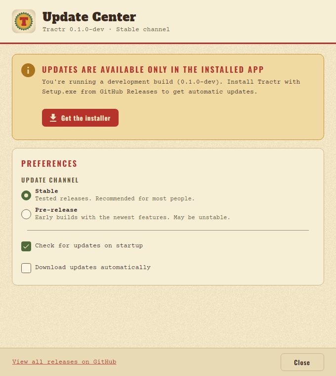

# Troubleshooting

Answers to the problems people run into most. If yours isn't here, open an
[issue](https://github.com/JX-Holdings-LLC/tractr/issues) with the Tractr
version (**Help → About Tractr**), what you did and what happened; attach
the project (**File → Export Project JSON…**) when you can. Security
problems go through [SECURITY.md](../SECURITY.md) instead.

## Installing and updating

**Windows says "Windows protected your PC".** The installer is not
code-signed yet. Choose **More info → Run anyway** ([Install](INSTALL.md#windows)).

**macOS says Tractr can't be opened.** The Mac app is not notarized yet.
Open **System Settings → Privacy & Security** and choose **Open Anyway**.

**The Linux AppImage doesn't start.** Make it executable
(`chmod +x Tractr-linux-x64.AppImage`), run it from a folder you can write
to, and install the runtime packages in [Install](INSTALL.md#linux) (FUSE 2
is the one most often missing).

**The Update Center says "Updates are available only in the installed
app".** You are running a copy built from source or run from an IDE, which
can't update itself. Install from the
[latest release](https://github.com/JX-Holdings-LLC/tractr/releases/latest);
your projects stay where they are.

**The Update Center shows an error.** It needs to reach GitHub, which allows
about 30 checks an hour from one network. Try again later, or download the
installer by hand.

## Projects

**Where are my projects?** In Tractr's data folder, one folder per project
([Install](INSTALL.md#where-tractr-keeps-things)). **File → Export Project
JSON** writes the whole project as one file anywhere, and **File → Import
Project JSON** reads one back, or the `project.json` of a project folder.

**A project doesn't open.** The editor says why:

- *A newer schema version*: the project was saved by a newer Tractr. Update
  first. Projects that use gameplay features added in 0.11 (weekdays,
  festivals, forage, skills, request boards and the rest) are saved as schema
  version 3, which older editors refuse rather than lose.
- *Another format*: Tractr reads its own project JSON (schema versions 2 and
  3) and does not import other formats or older ones.
- Anything else: keep a copy of the project folder and open an issue with it.

**The editor shows an error instead of closing.** Choose **Try Again**, or
**Undo last change and try again** if it happened right after an edit. Your
project is saved up to the error.

**A red banner says the project can't be saved.** The disk is full or the
folder is read-only. Fix that and choose **Retry save**; until then
**File → Export Project JSON…** keeps a copy anywhere.

## Playing and testing

**The keys do nothing in Play Mode.** Click the game to give it the
keyboard. F5 and F6 always switch modes.

**My changes vanished after playtesting.** Playtests are thrown away when
you return to Edit Mode, unless **Keep changes** was on
([Play Mode](CREATOR-GUIDE.md#3-playtest-in-play-mode)).

**A sound or music file doesn't play.** Tractr plays Ogg Vorbis and PCM WAV
up to 10 minutes. Ogg Opus, compressed WAV and damaged files are Problems
errors; convert them (Audacity exports Ogg Vorbis).

**Text shows as boxes.** The game's fonts cover Latin, Greek and Cyrillic.
Other scripts aren't supported yet; Problems warns about them.

**A plugin doesn't do anything.** See [When a plugin
fails](PLUGINS.md#when-a-plugin-fails): usually a hook or mutation missing
from the pack's permissions.

**There is no sound on Linux.** Install ALSA (`libasound2`, or
`libasound2t64` on Ubuntu 24.04); without it Tractr runs silently.

## Exporting

**Export Game stops with errors.** Open the Problems tab and fix every
error; **Go to** jumps to each one.

**Export Game says "The player template has no … slot. Use the templates
that came with this editor." or "The … player template has no …".** The
player templates in the `players` folder next to the app don't match this
editor (another version, or a partial copy). Reinstall Tractr; from source,
run `dotnet build` again. `FARM_PLAYER_TEMPLATES` points the editor and
`farmc` at another folder.

**The web demo is blank when I open `index.html`.** Browsers only run it from
a web server: `python3 -m http.server` in its folder, then open
<http://localhost:8000> ([The web demo](EXPORT.md#the-web-demo)).

**Players see "Windows protected your PC".** Exported games aren't signed;
sign `<Game>.exe` with your own certificate ([Code signing](EXPORT.md#code-signing)).

**A player's game crashed.** Ask for the crash log (next to their saves) and
their last save ([Crash logs](PLAYER.md#crash-logs)).

## Building from source

**A Linux build fails in `alsa-sys` or `libudev-sys`.** Install the build
packages: `sudo apt-get install libasound2-dev libudev-dev pkg-config`
([CONTRIBUTING.md](../CONTRIBUTING.md#prerequisites)).
