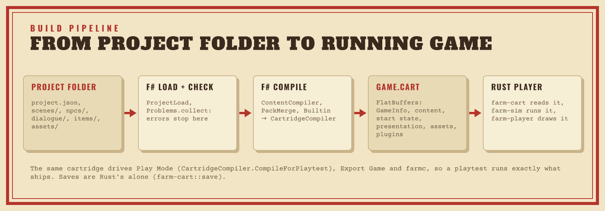

# Export internals

How **File → Export Game…** and `farmc export` build a game. What creators
see is in [Export Game](../EXPORT.md); the player inside an exported game is
in [Player internals](PLAYER-INTERNALS.md).



```text
project ──▶ F# compiler ──▶ game.cart ──┐
                                        ├──▶ export folder ──▶ zip / tar.gz
player template for the target ─────────┘    (renamed exe, icon, version info,
                                              license notices)
```

## Principles

- **No toolchain on the creator's machine.** Export never compiles Rust or
  .NET code. It copies a prebuilt player template, patches metadata and
  writes files, so any editor exports every target.
- **The cartridge sits next to the player, never appended to it.**
  Appending data to an executable gets in the way of code signing (macOS
  rejects it outright), and every content patch would re-ship the runtime,
  because Steam computes patches per file. The player loads `game.cart` from
  its executable's folder; `--cart <path>` overrides that for development.
- **Headless export.** `farmc export` runs the same code as the menu
  command (`Exporter.run`), so creators can build in CI.
- **Reproducible.** The same project exported by the same editor version
  gives a byte-identical `game.cart`: the cartridge holds no timestamps.
  Archives sort their entries and use one fixed timestamp (1980-01-01), no
  owner names and a fixed gzip header, so two exports on the same machine are
  byte-identical. Icons are the exception across machines: Skia and zlib may
  pick CPU-specific code paths, so icon bytes (and the files holding them)
  can differ between machines. The cartridge never does.
- **Errors block export.** Export runs the Problems pipeline first; any error
  stops it, and warnings go into the report.
- **Only used assets ship.** The compiler embeds the assets the game uses and
  the report lists the others as warnings. An asset is used when anything in
  the project outside the asset list names its id or data URL, when it is the
  art of a tile type in use, or when a used asset's frames draw from it
  (`AssetUsage` in F#). A coincidental match keeps an asset; a used asset is
  never left out.

## Writing the output

Each target gets its own folder under the output folder and an archive next
to it. The folder and the archive are written under hidden temporary names
next to where they go (`.WillowCreek.export-…`), then renamed into place,
the old folder moved aside first. A failure part-way (a full disk, the game
still running with its executable locked) or a cancelled export leaves the
previous export as it was.

- Export refuses to write into a game folder that holds files it wouldn't
  write. Files a file manager leaves behind (`.DS_Store`, `Thumbs.db`,
  `desktop.ini`, KDE's `.directory`) don't count.
- Export never writes through a link: a symbolic link (or junction) in the
  game folder, as the target folder or where the archive goes fails that
  target, so a link planted in a shared output folder can't redirect a write.
- A failure of any kind fails only its own target, with a sentence in the
  report. `Exporter.run` never throws, and `farmc export` prints the report.

The Linux `.desktop` file starts the game from the folder it sits in
(`Exec=sh -c "exec \\"\\$(dirname \\"\\$0\\")/WillowCreek\\"" %k`), which works in
launchers that pass the file's location. Its `Icon=WillowCreek` works once
the game is installed with its `.png`. The file passes
`desktop-file-validate`. Linux executables carry no icon, and Steam uses its
own store art.

### The web page

The web template is `farm-wasm`'s standalone player plus a page
(`tools/wasm/web-template`): `index.html`, `style.css`, `game.js` (canvas
loop, input, sound, saves in `localStorage`) and the wasm-bindgen bindings.
The page passes the screen's pixel density with every frame, so the
interface keeps its size in CSS pixels on dense phone screens. Touch
controls send the player `action` events, so they keep working after a
player rebinds keys. Stored settings the game can no longer read are reset
with the saves kept, and a stored document it cannot read at all is kept
aside under `<key>:unreadable`.

The page sets a Content-Security-Policy in a `<meta>` tag:
`default-src 'none'; script-src 'self' 'wasm-unsafe-eval'; connect-src 'self';
img-src 'self'; style-src 'self'; base-uri 'none'; form-action 'none'`. It
loads only its own files and runs nothing inline (its styles are in
`style.css`), so a later change that put text into the page could not run
script through it. Export adds the policy to a template page that has none,
and escapes the game's title into the page.

### License notices

`licenses/THIRD-PARTY.txt` lists the Rust crates in the player with their
license texts. [cargo-about](https://github.com/EmbarkStudios/cargo-about)
generates it (`tools/player-licenses/generate.sh`, checked in; CI fails when
it is stale). The script appends what cargo-about can't see: the embedded
fonts, the plugin sandbox's QuickJS, rquickjs-sys and wasi-libc
(`tools/player-licenses/plugin-guest`), and the engine's own license. Every
template ships it and export copies it.

## Player templates

A template is a folder per target with the player, its manifest and the
license notices:

```text
players/windows-x64/farm-player.exe   players/linux-x64/farm-player
players/windows-x64/template.json     players/linux-x64/template.json
players/windows-x64/THIRD-PARTY.txt   players/linux-x64/THIRD-PARTY.txt
```

The desktop templates are `farm-player` with its default features, so an
exported game draws with the GPU renderer when the machine has a working
Vulkan or DirectX 12 GPU, and with the CPU renderer otherwise
([Renderers](PLAYER-INTERNALS.md#renderers)).

`template.json` is `{ "target": "linux-x64", "version": "0.2.0", "sha256": "…",
"files": { "THIRD-PARTY.txt": "…" } }`: `sha256` is the executable's (for the
web, the module's) and `files` has every other file export uses (the license
notices, and for the web `index.html`, `game.js`, `style.css` and
`farm_wasm.js`). Export refuses a template for another target, another
editor version, or with any file that doesn't match its checksum or has none.
It reads each file once and writes those checked bytes. A missing template
fails that target only.

Export looks for templates in `--templates` (farmc) or
`ProjectCommandHandler.PlayerTemplatesFolder` (the app), then
`FARM_PLAYER_TEMPLATES`, then `players/` next to the running executable.

- **Releases.** The release workflow builds the three templates (Windows on
  the Windows runner, Linux in the Steam Runtime 3 "sniper" SDK container so
  it runs on older distributions and the Steam Deck, web with
  `tools/wasm/build.sh`), ships them in the app's `players/` folder through
  `-p:FarmPlayerTemplatesDir`, and attaches them to the release as
  `player-windows-x64.zip`, `player-linux-x64.tar.gz` and `player-web.tar.gz`
  (`tools/player-templates/package.sh` stages them and hashes every file).
- **Development builds** get the host's template from the
  `FarmPlayerTemplates` target in `src/FarmEngine.Export/FarmEngine.Export.fsproj`,
  which runs `cargo build -p farm-player` and writes `template.json` with the
  build's version; the app, farmc and the tests all get it in their output.
  For the web template, run `tools/wasm/build.sh`, then
  `tools/player-templates/package.sh web <editor version> tools/wasm/dist <dir>`
  and point `FARM_PLAYER_TEMPLATES` (or `--templates`) at `<dir>`.

## Windows icon and version info

Export rewrites the icon and `VERSIONINFO` without a resource compiler, and
without moving anything in the file:

1. **Placeholders in the template.** On Windows targets,
   `crates/farm-player/build.rs` compiles a resource script with
   `embed-resource` (`rc.exe` on MSVC, `windres` on GNU). It holds icon group
   1 with four PNG icon slots (16, 32, 48 and 256 pixels) and a `VERSIONINFO`
   with nine 200-character strings. Each icon slot is a 1×1 PNG padded with
   zeros to `n×n×4 + n + 1024` bytes, room for any 8-bit RGBA PNG of that
   size. That reserves about 281 KB.
2. **Patch in place.** `PeResources` (F#) parses the PE headers and the
   `.rsrc` tree (type → name → language → data entry). The room for each
   resource is the gap to the next resource structure or the end of the
   resource section (and of the file). Resource data outside the resource
   section, or a directory table reached twice, makes the template unusable,
   so patching only ever rewrites bytes of the resource section. It writes
   Skia's PNGs into the icon slots, updates the icon group entries (size, 32
   bits, byte count), writes a fresh `VS_VERSIONINFO` (`VersionInfo`) into the
   version slot, shrinks each data entry's size, zeroes the rest of the slot,
   sets the optional header's `Subsystem` from console (3) to GUI (2), and
   recomputes the PE checksum. The template is a console program, so
   `--headless` and `--screenshot` print to a terminal; the exported game is a
   GUI program, so double-clicking it opens no console window behind the game.
   Its error screen replaces the console's messages
   ([Crash logs](../PLAYER.md#crash-logs)).
3. **Clear failures.** A template without the slots, data larger than its slot
   (a very long title, say) or a file that isn't a PE gives one sentence in
   the report, never a broken executable.
4. **Signed templates.** Changing the executable breaks an Authenticode
   signature, and Windows treats an invalid signature worse than none, so a
   signed template's certificate table is cut off the end of the file and its
   Security directory cleared before the checksum is computed. The report says
   so.

The version info has `ProductName` and `FileDescription` (the title; Task
Manager shows the description), `FileVersion`/`ProductVersion` (the version
string, and its leading numbers in the fixed info), `CompanyName` and
`LegalCopyright` (the company, else the author), `InternalName`,
`OriginalFilename` and a "Made with Tractr" comment. The icon is the export
`icon` asset scaled into a square (`Icons.render`, PNG only), or the default
icon (`default-game-icon-256.png`, from `scripts/generate-game-icon.py`).

The tests patch `tests/FarmEngine.Export.Tests/Fixtures/pe/player-fixture.exe`,
a 56 KB program built by mingw's gcc and windres with the same layout and
smaller slots (`build.sh` next to it rebuilds it), and read everything back.
`wrestool`/`icotool`, `objdump -p` and Python's `pefile` read the patched files
correctly, and pefile agrees with the checksum. CI exports a game on the
Windows runner and checks its version info and its GUI subsystem with
PowerShell.

### The C runtime

`.cargo/config.toml` builds every Windows target with
`-C target-feature=+crt-static`: the Visual C++ runtime is linked into
`farm-player.exe` and `farm_ffi.dll`, so exported games and the editor's Play
Mode work on a clean Windows install without the VC++ redistributable
(`VCRUNTIME140.dll`). The CI runners have the redistributable installed, so CI
checks the binaries' imports with `dumpbin /dependents` instead and fails on
`VCRUNTIME`, `MSVCP` or `api-ms-win-crt-` DLLs. A `RUSTFLAGS` environment
variable would replace the config's flags, so release builds don't set one.

## Export settings in the project

Export settings live in the project's optional `export` object; JSON import
and export keep it. `Defaults.newExportSettings` creates `gameId` once from
the project id (`local.<slug>`); later title changes leave it alone. F#
`ChecksExport`, called by `Problems.collect`, validates the block (a game id
needs at least two lowercase dot-separated parts; an executable name is 1–64
letters, digits, `-` or `_`, not a device name such as `CON` or `COM1`, nor
`licenses`) and its errors block export. Settings → Export edits every field
except `gameId` and `targets` (Export Game records them), and shows the
`ChecksExport` problems inline. Without an executable name, export uses the
title's slug, cut to 64 characters, with `-game` added to a reserved name.

## Compatibility rules

These decisions are expensive to change once games have shipped:

- **Saves store content by stable string id**, never by a cartridge's
  interned indices: a save from version 1.0 of a game must load in 1.1 after
  the creator adds an item. Ids that no longer exist go to quarantine
  (`QuarantinedItems`) instead of failing the load. A save from another
  version of the game takes that version's maps (tiles, doors, new scenes)
  while keeping what the player did on them, and NPCs new in the game join
  the world.
- **The save header carries** `gameId`, the game version, the cartridge
  content hash and the save format version. The player refuses a save from a
  different `gameId`, loads saves from older game versions, and warns about
  saves from newer ones.
- **The player never reads project JSON.** `cart.fbs` has a `GameInfo` table
  (title, version, `gameId`, author, window defaults, pixel scale) and an
  asset table keyed by id.
- **`farm-sim` does no file, environment or clock access**, so the web
  player can run it, and **the compiler is deterministic and independent of
  the app**, so `farmc export` runs anywhere.

## Code map

| Piece | Where |
|---|---|
| Orchestration, report, C# entry points | `src/FarmEngine.Export` (F#): `Exporter.run`, `GameExporter.Export` |
| Menu command and dialog | `ProjectCommandHandler.ExportGameAsync`, `ExportGameViewModel`, `ExportGameWindow` |
| CLI | `farmc export` in `src/FarmEngine.Cli` |
| The game: window, title screen, saves, settings, gamepads | `crates/farm-player`, `crates/farm-ui` ([Player internals](PLAYER-INTERNALS.md)) |
| Placeholder resources | `crates/farm-player/build.rs` |
| Templates | `FarmPlayerTemplates` MSBuild target, `tools/player-templates/package.sh`, release workflow |
| License notices | `tools/player-licenses` |

The F# API:

- `Exporter.run : ExportOptions -> GameProject -> ExportReport` runs everything.
  `ExportOptions` has `Targets`, `OutputFolder`, `TemplatesFolder`,
  `CreateArchives` and `EditorVersion`. It never throws for project, template or
  file problems; they are in the report.
- `Exporter.identity`, `Exporter.check` (Problems errors and warnings plus
  unused assets), `Exporter.package` (one target's files in memory) and
  `Exporter.format` (the report as text).
- `PeResources.read/patch/readIcons/readVersion/checksum`, `VersionInfo.build/parse`,
  `Icons.render`, `Templates.find`, `AssetUsage.unused`, `DesktopEntry.create`,
  `Archives.zip/tar/gzip/tarGz`.

From C#: `GameExporter.Export(project, targets, outputFolder, createArchives, templatesFolder)`,
`GameExporter.Summarize(project)` (title, executable, version, game id, last
targets, Problems counts), `GameExporter.TryRememberTargets(project, targets, out edit)`
(the undoable edit that records `export.targets`), `GameExporter.Targets`,
`GameExporter.EditorVersion`, `GameExporter.DefaultTemplatesFolder` and
`GameExporter.Format(report)`.

The report has, per target: the folder, the archive, each file with its size,
warnings and errors. At the top: the title, version, game id, the cartridge
size and SHA-256, errors that stopped the export and project warnings. The
dialog remembers the output folder and the archive choice in the app's
`settings.json`, records the chosen targets in the project, and opens folders
through `IUrlLauncher.OpenFolder`.

## Tests

- `tests/FarmEngine.Export.Tests` covers the folder layout per target,
  Problems errors blocking export, warnings and unused assets, identical
  archives and folders from two exports, the tar execute bit, the `.desktop`
  text, icon sizes, the PE patch round trip on the fixture (and its
  failures), template version and checksum refusal, a missing template
  failing one target, the web demo's files, its escaped title, its
  Content-Security-Policy and the flat zip, and an end-to-end export for the
  host target whose player runs headless and reports the right game id,
  version and hash. `Tractr.App.Tests` drives the dialog.
- CI exports `fixture-project.json` on Linux and Windows and runs the
  exported game against the checked-in replay; the release workflow does the
  same with the release templates (`tools/release/smoke-export.sh`).
- `tools/wasm/game-page.mjs` (CI) runs the page's `game.js` in Node against
  the real module with a stand-in for the browser: frames sized by pixel
  density, keys, the touch controls (also when pointer capture is refused),
  sound, saves through `localStorage` and a reload, a full storage,
  unreadable stored settings, and a missing `game.cart`; it also checks that
  `index.html` has nothing inline.
- The player's screenshot goldens (`fixtures/player/`) pin the title screen,
  settings, gameplay HUD, dialogue and shop at 1280×800 and 1920×1080, drawn
  by the same code in the embedded, standalone and web players.

## Open questions

- **Steamworks.** Achievements, the Steam overlay and Steam Input need an
  optional `steam` feature in `farm-player`
  ([steamworks-rs](https://crates.io/crates/steamworks)): a template variant
  that ships Valve's redistributable library, plus the achievements' `steamId`
  the project already stores.
- **Start state vs. playtest state.** The project mixes the authored start
  state with state kept from playtests (**Keep changes** writes the day,
  season, animals, friendships and more back into the project), and the
  cartridge's start section is built from the project as it is. An exported
  game needs an explicit "a new game starts here" state, so that a kept
  playtest doesn't ship as the opening of the game.
- **Player-installed mods** for exported games: see
  [Architecture](ARCHITECTURE.md#open-questions-and-settled-decisions).
- **Web demo limits.** Should the web target offer a "the demo ends after
  day N" option?
- **macOS games.** They need a Mac (or [rcodesign](https://github.com/indygreg/apple-platform-rs))
  for signing and notarization, and each creator needs their own Apple
  Developer account.
