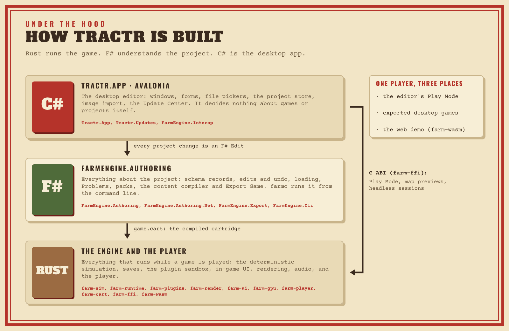

# Contributor handbook

For people changing Tractr itself. If you make games or packs with Tractr,
the [handbook](../README.md) is for you instead.

Start with [CONTRIBUTING.md](../../CONTRIBUTING.md) (prerequisites, build,
test, the checks CI runs and how to regenerate checked-in files), then read
[Architecture](ARCHITECTURE.md) before you add anything.

| Page | What it covers |
|---|---|
| [Architecture](ARCHITECTURE.md) | The Rust / F# / C# split and where new code goes, the cartridge, saves, FFI and WebAssembly contracts, determinism rules, the repository layout, tests and benchmarks, and a checklist for adding an editor feature |
| [Code conventions](CONVENTIONS.md) | Schema records in F# and Rust, state, determinism rules and tests |
| [Native numerics](NUMERICS.md) | The integer type and unit of every quantity, randomness, the state hash and the goldens |
| [Editor architecture](EDITOR-ARCHITECTURE.md) | The C# app's views, view models and shared helpers |
| [Export internals](EXPORT-INTERNALS.md) | How Export Game builds a game: templates, PE patching, the web page, compatibility rules |
| [Player internals](PLAYER-INTERNALS.md) | `farm-player`: embedding, Play Mode, input, saves, audio, frames and renderers |
| [Plugin sandbox internals](PLUGIN-SANDBOX.md) | `farm-plugins`: the QuickJS guest, wasmi, fuel and hardening |
| [Image decoding and safety](IMAGE-SAFETY.md) | Where the editor decodes untrusted images and the defences around Skia |
| [Releasing](RELEASING.md) | Versions, the release workflow, how the Update Center finds releases, signing |

Crate and tool READMEs hold the details of their own corner:
[farm-wasm](../../crates/farm-wasm/README.md),
[the plugin guest](../../crates/farm-plugins/guest/README.md),
[schemas](../../schemas/README.md), [codegen](../../tools/codegen/README.md),
[built-in art](../../tools/art/README.md) and the
[player templates](../../tools/player-templates/README.md).

When you change what creators see, update the user docs too: the
[Creator guide](../CREATOR-GUIDE.md) is also the in-app help (its bold text
must be labels the editor shows, and its pictures in `docs/media/guide` are
embedded in the app), and the figures in `docs/media` are drawn by
`docs/brand/vixl/kit/build_diagrams.py` ([Brand](../brand/README.md#rebuilding-the-pictures)).
