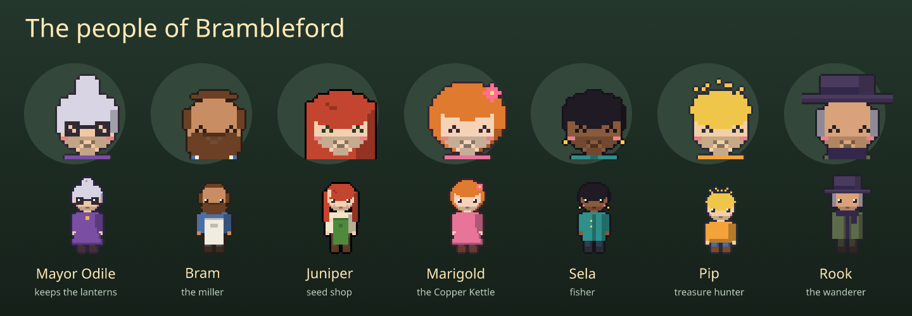
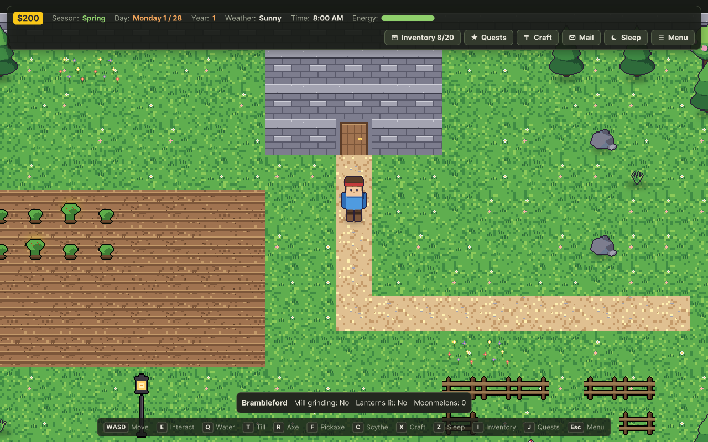
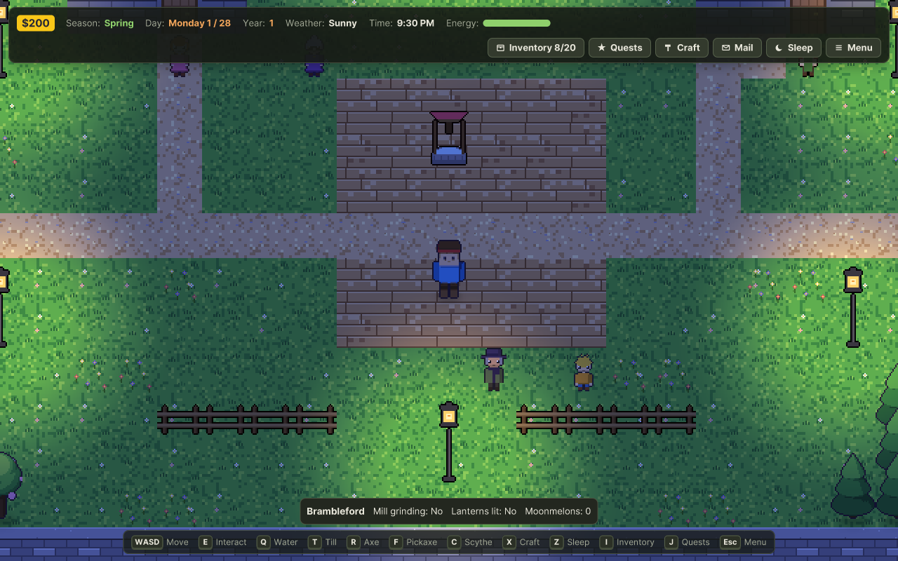
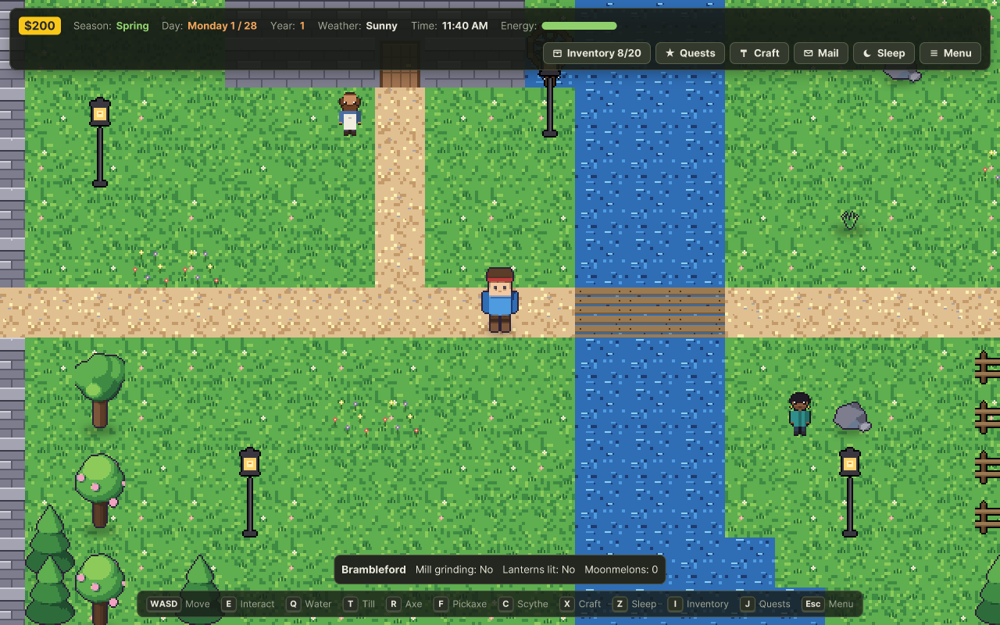
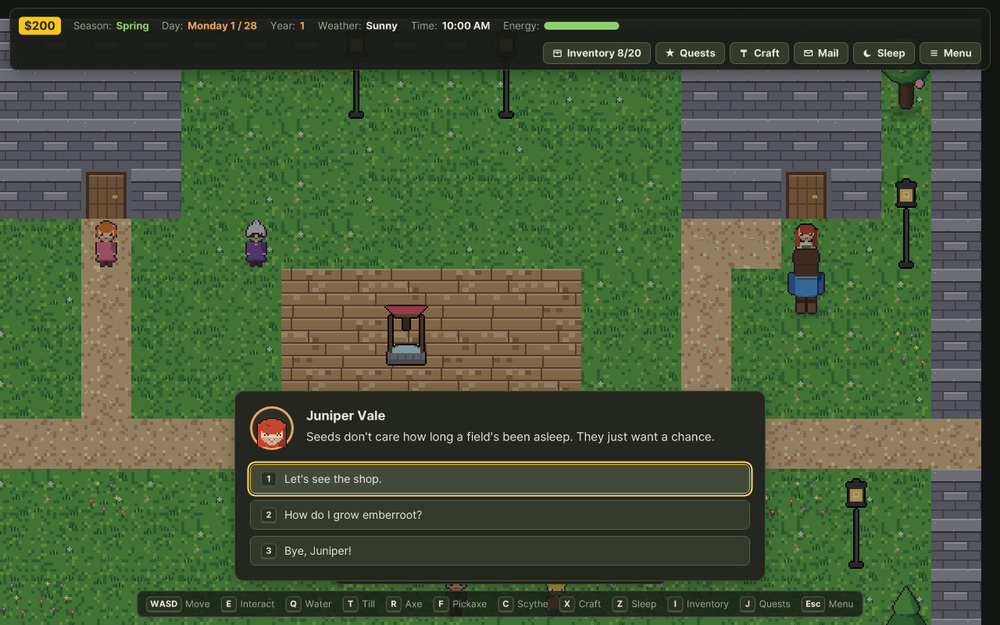

# Brambleford: a short Tractr farming game

A small, complete demo game made with Tractr, with every sprite, portrait and prop drawn with
[Vixl](https://github.com/jxburros/Vixl). It plays in about a week of game days.



## The story

You inherit **Thistledown Farm** from your Aunt Wren. Her field has been asleep for a year, the
village mill has stopped grinding, and without the mill there are no moonmelon seeds, so Brambleford
hasn't lit its lanterns for Lantern Night since she died.

1. **Roots in the Ground** (Mayor Odile, starts at once): wake the field up by harvesting 5 emberroot.
2. **The Silent Mill** (Bram, at the riverside): bring him 10 wood and 5 stone to mend his grindstone.
   The mill grinds again, Juniper stocks moonmelon seeds and Bram writes you a letter.
3. **Lantern Night** (Mayor Odile): harvest 3 moonmelons. The whole village gathers in the square for
   the closing cutscene, and the lanterns are lit.

Side quests: **Real Ember Stew** for Marigold, **Something's Biting** with Sela, and **Pip's Treasure
Map**, which sends you to ask Rook.

## What is in it

| | |
|---|---|
| **3 locations** | Thistledown Farm (field, farmhouse, chicken pen), Brambleford Square (well, café, seed shop, lanterns) and Millbrook Riverside (mill and wheel, river, bridge, fishing) |
| **7 villagers** | Mayor Odile, Bram the miller, Juniper the seed seller, Marigold the café owner, Sela the fisher, her little brother Pip and Rook the wanderer, each with their own sprite sheet and happy, neutral and sad portraits |
| **2 crops** | Emberroot (3 days, spring and summer) and Moonmelon (5 days, regrows every 3, glows at night) |
| **Living village** | Daily schedules across all three scenes, daily lines that change with the weather, time of day, birthdays and story progress, gift tastes, two birthdays, a heart event with Sela, a wandering Rook, two hens, lanterns that light up after dark |
| **Story** | 6 quests, 6 events, 2 cutscenes, 3 letters (one from Aunt Wren on day 2), a shop that gains stock as the story moves on, a Lantern Night festival on the calendar and an on-screen panel that tracks the village's progress |
| **Recipes** | Ember Stew and Moonmelon Jam, both edible |

| Morning on the farm | The square at night | The riverside |
|---|---|---|
|  |  |  |



## Play it

Copy [`project/`](project) into Tractr's projects folder (see the
[Creator guide](../../docs/CREATOR-GUIDE.md#1-start-a-project)), or use **File → Import Project JSON** and
pick `project/project.json`, then press **F5**. From the command line:

```sh
dotnet run --project src/FarmEngine.Cli -- compile examples/brambleford/project --out brambleford.cart
cargo run -p farm-player -- --cart brambleford.cart
```

`farmc export examples/brambleford/project --out dist` builds the targets in its export settings (Windows, Linux and the web demo)
([Export Game](../../docs/EXPORT.md)).

## How it is made

Everything is generated from the scripts here, so the game can be changed and rebuilt:

| File | What it does |
|---|---|
| [`art/people.py`](art/people.py) | Draws each villager's 16-frame walking sheet (down, left, right, up) and three portraits as palette grids |
| [`art/props.py`](art/props.py) | The crops' five growth stages, the item icons and seed packets, and the map props: lantern, fence, wildflowers, mill wheel, bridge and well |
| [`art/make_art.py`](art/make_art.py) | Hands every grid to Vixl as a `pixel-art` layer (Vixl adds the outline), saves each sheet as an editable `.vixl` master in `art/masters/` and exports the PNG |
| [`art/make_cast.py`](art/make_cast.py) | Composes the cast card above in Vixl |
| [`tools/make_project.py`](tools/make_project.py) | Writes the game: maps, terrains, crops, items, villagers, dialogue, quests, events, mail, cutscenes and art assets, on top of the Quest RPG template's tools and materials |
| [`tools/*.fsx`](tools) | Small F# scripts over Tractr's own authoring library: the template, single file to project folder, and the Problems check |

```sh
dotnet build src/FarmEngine.Cli -c Release   # once, for the F# scripts
pip install vixl-engine pillow               # or an editable install of the Vixl repository
examples/brambleford/build.sh
```

The build ends with Tractr's Problems check; the one warning left (the template's fishing minigame has
no result tiers) is harmless.

Tractr fits creator art for villagers and crops into one tile, so the villagers stand a little shorter
than the built-in player character.
